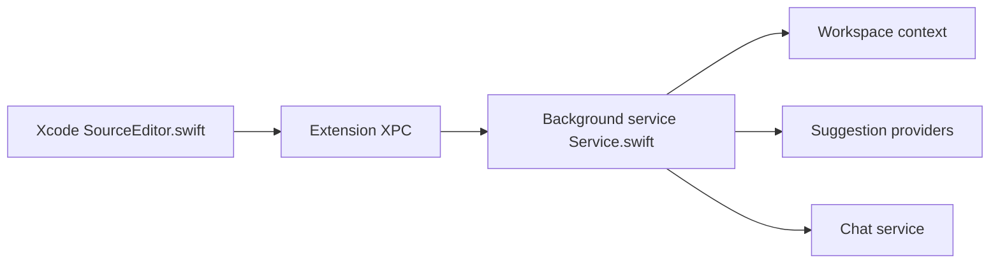

# intitni/CopilotForXcode

> macOS extension for Xcode adding suggestions, chat and code editing via Copilot, Codeium or OpenAI.

## The problem
Xcode does not natively offer an AI coding assistant, nor a contextual chat.

## What it actually does
A background service reads the editor context, queries the configured provider (GitHub Copilot, Codeium, compatible LLM) and displays suggestions, chat or edits. Custom commands allow reusable prompts. It requests Accessibility and Folders access.

## How it is wired


## Trying it
```bash
brew install --cask copilot-for-xcode
```
Then enable the extension in System Settings and grant Accessibility.

## Cost and gotchas
Copilot subscription or Codeium account, or a pay-per-use OpenAI key; Node required for the Copilot server. The README admits fragile Xcode tracking with several windows.

## What it is not
Not an offline tool: it depends on third-party services. Last push in April 2026, modest activity.

## Alternatives
No alternative named in the README.

## For you
Ignore for a data/AI profile: it is an iOS/macOS development tool, unrelated to your scope.
