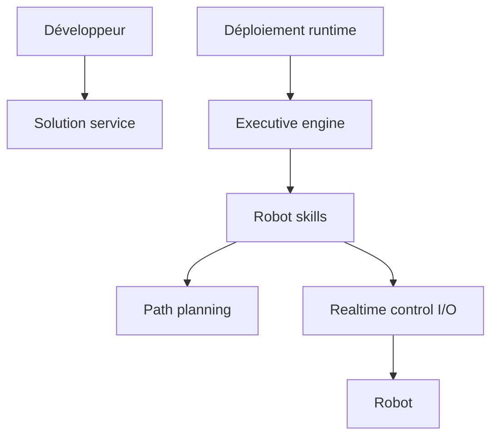

# intrinsic-ai/intrinsic-core

> Open runtime and real-time control framework for industrial robots, with simulation and perception.

## The problem
Programming an industrial robot means stitching together simulation, planning, perception and hardware drivers specific to each manufacturer.

## What it actually does
- Local containerized runtime on k3s, on top of ROS 2.
- ICON real-time control with a hardware abstraction layer to swap arms and grippers without rewriting drivers.
- Collision-free motion planning, 6-DoF pose estimation with NVIDIA FoundationPose, and local inference.
- SDK for building skills, and a reference machine-tending solution (OMTS).

## How it is wired


## Trying it
```bash
# Aucune commande documentée dans le README : voir le Getting Started guide.
```

## Cost and gotchas
Requires Ubuntu 24.04 or 26.04 and ROS 2 Lyrical Luth. Perception relies on NVIDIA's FoundationPose, so a GPU is needed. "Intrinsic Core" is a registered trademark.

## What it is not
Not a general-purpose ML framework: it is a system for industrial robotics. The README does not detail installation.

## Alternatives
- intrinsic-moveit: MoveIt 2 integration, listed among the related repositories.

## For you
Worth watching: interesting if you are getting into AI for industrial robotics, otherwise too far from your daily work.
