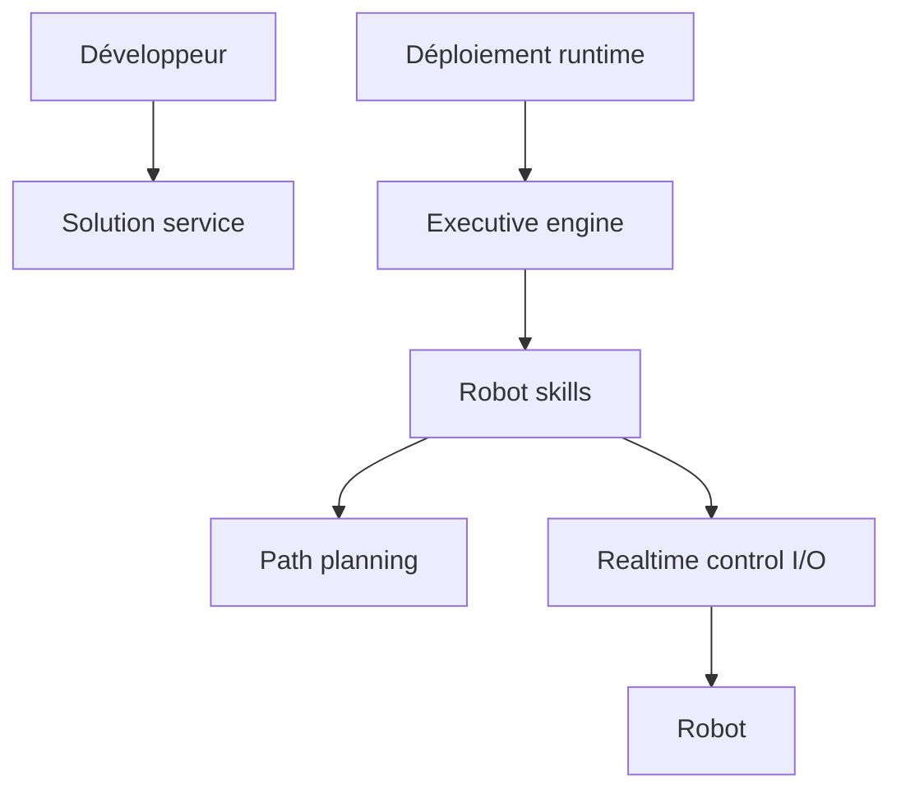

# intrinsic-ai/intrinsic-core

> Runtime ouvert et cadre de contrôle temps réel pour robots industriels, avec simulation et perception.

## Le problème
Programmer un robot industriel impose de recoller simulation, planification, perception et pilotes matériels propres à chaque fabricant.

## Ce que ça fait vraiment
- Runtime local conteneurisé sur k3s, au-dessus de ROS 2.
- Contrôle temps réel ICON avec couche d'abstraction matérielle pour changer bras et pinces sans réécrire les pilotes.
- Planification de mouvement sans collision, estimation de pose 6 degrés avec NVIDIA FoundationPose et inférence locale.
- SDK pour créer des skills, et solution de référence de service de machines (OMTS).

## Comment c'est branché


## Essayer
```bash
# Aucune commande documentée dans le README : voir le Getting Started guide.
```

## Coût et pièges
Ubuntu 24.04 ou 26.04 et ROS 2 Lyrical Luth requis. La perception s'appuie sur FoundationPose de NVIDIA, donc un GPU. Marque « Intrinsic Core » déposée.

## Ce que ce n'est pas
Pas un framework ML généraliste : un système pour la robotique industrielle. Le README ne détaille pas l'installation.

## Alternatives
- intrinsic-moveit : intégration MoveIt 2 listée parmi les dépôts liés.

## Pour toi
À surveiller : intéressant si tu t'approches de l'IA pour la robotique industrielle, sinon trop éloigné de ton quotidien.

