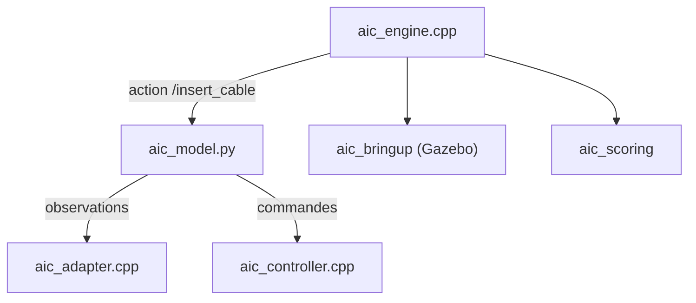

# intrinsic-dev/aic

> Toolkit for the AI for Industry competition: train a robot policy that inserts cables in simulation.

## The problem
Entering a robotics competition means setting up a simulation, controller and scoring identical to the organizers'.

## What it actually does
The evaluation side (provided) runs the trials, the robot and the sensors under Gazebo and scores the result (`aic_engine`, `aic_bringup`, `aic_controller`, `aic_adapter`, `aic_scoring`). You provide a ROS 2 node `aic_model` that loads your Python policy and answers the `/insert_cable` action. Examples, a LeRobot bridge and Isaac Lab tasks exist.

## How it is wired


## Trying it
```bash
# Aucune commande dans le README : suivre le guide Getting Started de docs/
# (conteneur d'évaluation et espace de travail Pixi).
```

## Cost and gotchas
Free, but the official evaluation uses ROS 2 Kilted Kaiju on Ubuntu 24.04; developing in a container is recommended. No GPU requirement is explicitly mentioned: to be confirmed for the simulation. Submission goes through the competition portal.

## What it is not
Not a general-purpose robotics framework: it is tied to the competition and its cable insertion task.

## Alternatives
No alternative named in the README; LeRobot is cited as an integration.

## For you
Worth watching: robot policy learning in simulation, relevant if you aim at robotics or embedded AI.
