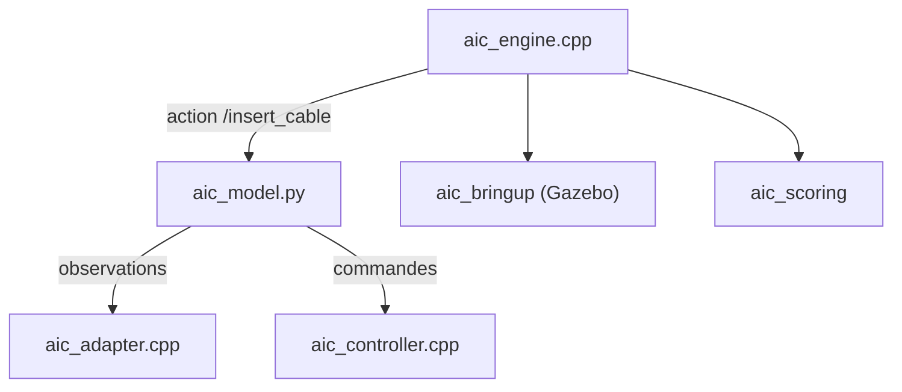

# intrinsic-dev/aic

> Boîte à outils du concours AI for Industry : entraîner une politique robot qui insère des câbles en simulation.

## Le problème
Participer à un concours de robotique oblige à monter simulation, contrôleur et notation identiques à ceux des organisateurs.

## Ce que ça fait vraiment
Le côté évaluation (fourni) lance les essais, le robot et les capteurs sous Gazebo et note le résultat (`aic_engine`, `aic_bringup`, `aic_controller`, `aic_adapter`, `aic_scoring`). Tu fournis un nœud ROS 2 `aic_model` qui charge ta politique Python et répond à l'action `/insert_cable`. Des exemples, un pont LeRobot et des tâches Isaac Lab existent.

## Comment c'est branché


## Essayer
```bash
# Aucune commande dans le README : suivre le guide Getting Started de docs/
# (conteneur d'évaluation et espace de travail Pixi).
```

## Coût et pièges
Gratuit, mais l'évaluation officielle utilise ROS 2 Kilted Kaiju sous Ubuntu 24.04 ; développer dans un conteneur est conseillé. Aucun prérequis GPU n'est cité explicitement : à confirmer pour la simulation. La soumission passe par le portail du concours.

## Ce que ce n'est pas
Pas un framework de robotique généraliste : c'est lié au concours et à sa tâche d'insertion de câble.

## Alternatives
Aucune alternative nommée dans le README ; LeRobot est cité comme intégration.

## Pour toi
À surveiller : de l'apprentissage de politiques robotiques en simulation, pertinent si tu vises la robotique ou l'IA embarquée.

