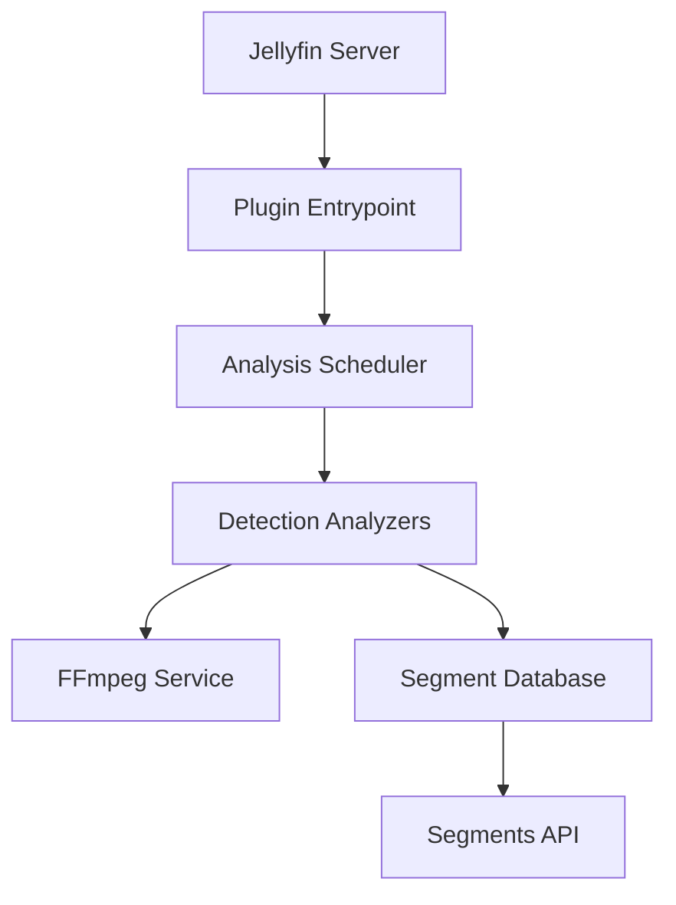

# intro-skipper/intro-skipper

> Jellyfin plugin that analyzes episode audio to detect and skip opening credits.

## The problem
Manually skipping the intro and recap in every episode of a series is tedious.

## What it actually does
Analyzes files locally (Chromaprint audio fingerprints, silence and black frame detection via jellyfin-ffmpeg), stores the segments in a database and exposes them to Jellyfin for the "skip" button. Administration interface to correct, hide and rescan. Requires Jellyfin 12.0.0+ and jellyfin-ffmpeg 7.1.3-1+. The File Transformation plugin is optional.

## How it is wired


## Trying it
```bash
https://intro-skipper.org/manifest.json
```
(Manifest URL to add as a plugin repository in Jellyfin.)

## Cost and gotchas
Free. The manifest does not display in a browser. Sharing fingerprint data may infringe the rights of the source media, according to the README's warning.

## What it is not
Not a modification of the interface (since Jellyfin 10.10) nor an online service.

## Alternatives
No alternative named in the README.

## For you
Ignore: home media library, unrelated to data/AI/MLOps work.
