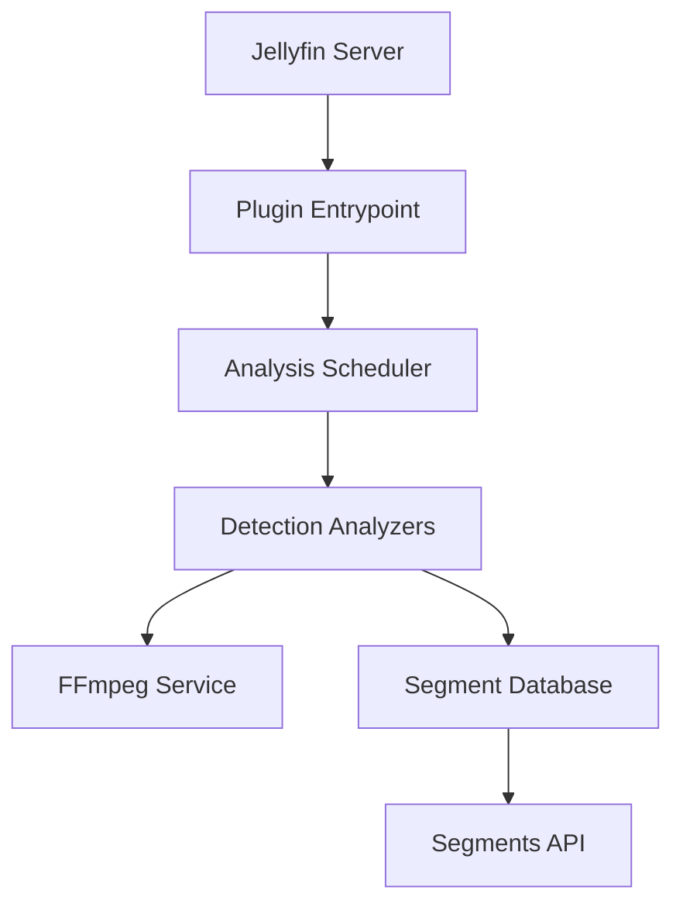

# intro-skipper/intro-skipper

> Plugin Jellyfin qui analyse l'audio des épisodes pour détecter et sauter les génériques.

## Le problème
Passer à la main générique et résumé à chaque épisode d'une série est fastidieux.

## Ce que ça fait vraiment
Analyse localement les fichiers (empreintes audio Chromaprint, détection de silence et d'images noires via jellyfin-ffmpeg), stocke les segments en base et les expose à Jellyfin pour le bouton « passer ». Interface d'administration pour corriger, masquer et rescanner. Exige Jellyfin 12.0.0+ et jellyfin-ffmpeg 7.1.3-1+. Le plugin File Transformation est optionnel.

## Comment c'est branché


## Essayer
```bash
https://intro-skipper.org/manifest.json
```
(URL de manifeste à ajouter comme dépôt de plugins dans Jellyfin.)

## Coût et pièges
Gratuit. Le manifeste ne s'affiche pas dans un navigateur. Partager les données d'empreintes peut enfreindre les droits des médias sources, selon l'avertissement du README.

## Ce que ce n'est pas
Pas une modification de l'interface (depuis Jellyfin 10.10) ni un service en ligne.

## Alternatives
Aucune alternative nommée dans le README.

## Pour toi
À ignorer : médiathèque domestique, sans lien avec le travail data/IA/MLOps.

