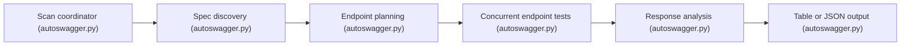

# intruder-io/autoswagger

> Command-line tool that finds OpenAPI specs and flags unauthenticated endpoints exposing sensitive data.

## The problem
APIs expose their Swagger documentation and open endpoints that leak personal data or secrets, without anyone noticing.

## What it actually does
- Finds the spec: direct URL, Swagger UI pages, or common paths (`/swagger.json`, `/openapi.json`).
- Tests GET endpoints by default (other methods with `-risk`), in parallel, with rate limiting (30 req/s by default).
- Analyzes responses: PII via Presidio, secrets via regex, large responses.
- Table or JSON output; the publisher acknowledges that the first version is incomplete.

## How it is wired


## Trying it
```bash
git clone git@github.com:intruder-io/autoswagger.git
pip install -r requirements.txt
python3 autoswagger.py -h
python autoswagger.py https://api.example.com -v
```

## Cost and gotchas
Free. All the code is in a single file. Last push in August 2025. Run it only on APIs you are responsible for or have authorization to test, because the tool sends real requests.

## What it is not
Not a complete API security scanner: some specification types are not handled. Results require manual verification.

## Alternatives
The README mentions Postman and Burp Suite to replay requests and confirm.

## For you
Keep an eye on it: useful for auditing your own data or model APIs, but the project has been inactive for over a year.
