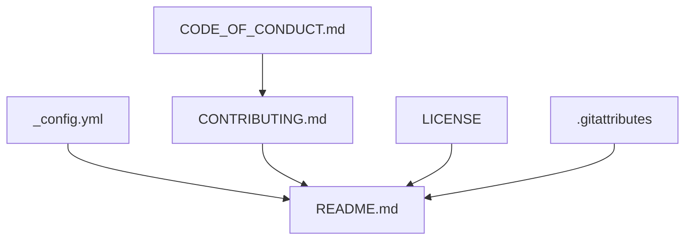

# inttter/md-badges

> Catalog of static Shields.io badges by category, to copy into a Markdown README.

## The problem
Composing consistent badges (languages, tools, services) means finding the right URL and style each time.

## What it actually does
A list sorted by category (AI, databases, data science, CI, cloud, editors, languages, social networks, etc.) with, for each badge, a preview and the Markdown code to copy. A separate command-line tool, mdbadges-cli, bundles the same badges.

## How it is wired

## Trying it
No command documented in the README: you copy a badge's Markdown code into your own README.

## Cost and gotchas
Free. The badges are served by Shields.io: a dependency on that image service.

## What it is not
Not a dynamic badge generator: static badges only.

## Alternatives
No alternative named in the README (mdbadges-cli is cited as a companion tool).

## For you
Ignore: useful for decorating READMEs, no effect on data/AI/MLOps work.
