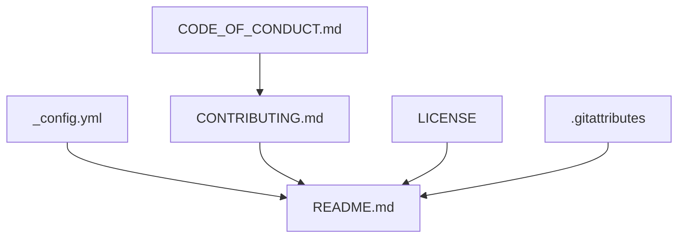

# inttter/md-badges

> Catalogue de badges Shields.io statiques par catégorie, à copier dans un README Markdown.

## Le problème
Composer des badges homogènes (langages, outils, services) demande de retrouver à chaque fois l'URL et le style adéquats.

## Ce que ça fait vraiment
Liste classée par catégories (IA, base de données, data science, CI, cloud, éditeurs, langages, réseaux sociaux, etc.) avec, pour chaque badge, un aperçu et le code Markdown à copier. Un outil en ligne de commande séparé, mdbadges-cli, regroupe les mêmes badges.

## Comment c'est branché

## Essayer
Aucune commande documentée dans le README : on copie le code Markdown d'un badge dans son propre README.

## Coût et pièges
Gratuit. Les badges sont servis par Shields.io : dépendance à ce service d'images.

## Ce que ce n'est pas
Pas un générateur de badges dynamiques : seulement des badges statiques.

## Alternatives
Aucune alternative nommée dans le README (mdbadges-cli est cité comme outil compagnon).

## Pour toi
À ignorer : utile pour décorer des README, sans effet sur un travail data/IA/MLOps.

