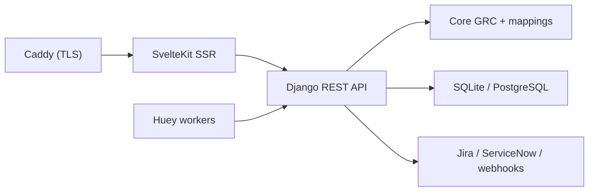

# intuitem/ciso-assistant-community

> Cybersecurity governance, risk and compliance platform, with more than 200 built-in frameworks.

## The problem
Security teams juggle spreadsheets and tools for compliance, risks, third parties and remediation, with a lot of duplication.

## What it actually does
A Django REST application with a SvelteKit frontend that separates reusable controls from per-framework assessment. It covers audits, a risk register, EBIOS RM, DORA, third parties, incidents, automation workflows, SSO/SCIM, Jira/ServiceNow, Kafka and MCP. Frameworks are versioned YAML or Excel libraries. An AI subsystem (RAG, Qdrant) is optional.

## How it is wired


## Trying it
```bash
git clone --single-branch -b main https://github.com/intuitem/ciso-assistant-community.git
cd ciso-assistant-community
./docker-compose.sh
```

## Cost and gotchas
The community edition is free; a cloud trial exists. Do not use `main` in production: prefer tags. Hardening is required (`DJANGO_DEBUG=False`, secrets, network).

## What it is not
Not a data science tool: it is compliance software. The license is present but not identified by GitHub.

## Alternatives
No alternative named in the README.

## For you
Ignore for a data/AI/MLOps profile, unless you have a compliance assignment: outside the technical scope, and the license needs checking.
