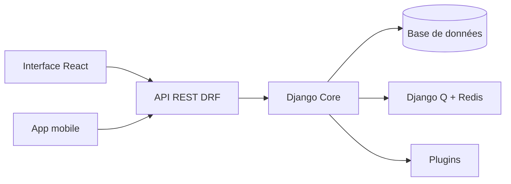

# inventree/InvenTree

> Open source inventory management and part tracking system, with a REST API and plugins.

## The problem
Tracking stock, parts, builds and orders in spreadsheets becomes unmanageable.

## What it actually does
Python/Django backend with an admin interface and REST API (DRF), React client (Mantine, TanStack Query, Zustand), Django Q tasks, Redis, PostgreSQL/MySQL/MariaDB/SQLite databases, a plugin system and a companion mobile app.

## How it is wired


## Trying it
```bash
wget -qO install.sh https://get.inventree.org && bash install.sh
```

## Cost and gotchas
Free, self-hosted: database, Redis and maintenance are on you.

## What it is not
Not a full ERP; not designed for data analysis.

## Alternatives
No alternative named in the README.

## For you
Ignore: a stock management application, unrelated to data/AI/MLOps unless you have a specific business need.
