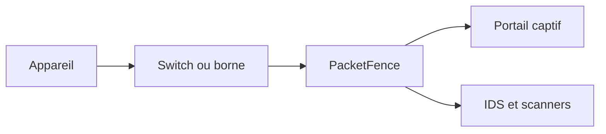

# inverse-inc/packetfence

> Free network access control (NAC) system, for network administrators of all sizes.

## The problem
Knowing who is connected to the network and granting different access depending on identity.

## What it actually does
- Captive portal for registration and remediation.
- Centralized wired and wireless management, 802.1X.
- Layer 2 isolation of problematic devices.
- Integration with IDS and vulnerability scanners.
- Interface translated into six languages. Details are in the administration guide.

## How it is wired

## Trying it
No documented command: refers to the administration guide.

## Cost and gotchas
Free but requires compatible equipment and a separate installation guide. GPL-2.0 license.

## What it is not
Not a firewall nor an application monitoring tool. The README does not quantify the required resources.

## Alternatives
No alternative named in the README.

## For you
Ignore: infrastructure network security, outside the data / AI / MLOps scope.
