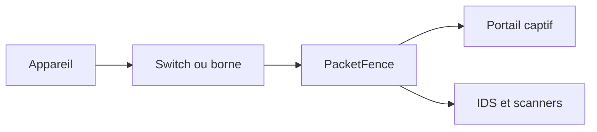

# inverse-inc/packetfence

> Système libre de contrôle d'accès réseau (NAC), pour administrateurs de réseaux de toutes tailles.

## Le problème
Savoir qui est connecté au réseau et donner des accès différents selon l'identité.

## Ce que ça fait vraiment
- Portail captif pour enregistrement et remédiation.
- Gestion centralisée filaire et sans fil, 802.1X.
- Isolation de couche 2 des appareils problématiques.
- Intégration avec des IDS et scanners de vulnérabilités.
- Interface traduite en six langues. Le détail est dans le guide d'administration.

## Comment c'est branché

## Essayer
Aucune commande documentée : renvoi au guide d'administration.

## Coût et pièges
Gratuit mais exige de l'équipement compatible et un guide d'installation séparé. Licence GPL-2.0.

## Ce que ce n'est pas
Pas un pare-feu ni un outil de supervision applicative. Le README ne chiffre pas les ressources nécessaires.

## Alternatives
Aucune alternative nommée dans le README.

## Pour toi
À ignorer : sécurité réseau d'infrastructure, hors périmètre data / IA / MLOps.

