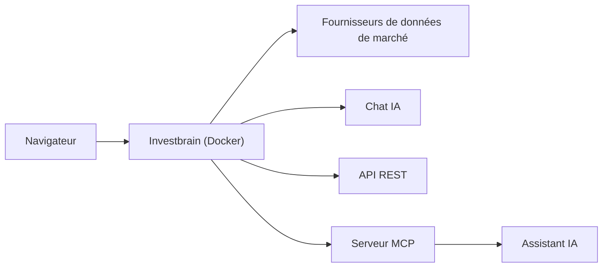

# investbrainapp/investbrain

> Open source investment portfolio tracker, with AI chat and an MCP server, in the cloud or self-hosted.

## The problem
Tracking your positions, dividends and splits means spreadsheets or closed services that keep your data.

## What it actually does
Investbrain manages portfolios, transactions, holdings, dividends and splits, with sharing, import/export and a REST API. It offers an AI chat and an MCP server for Claude, ChatGPT, Cursor or VS Code. You can sign up for the cloud version or self-host it with Docker. The README stays short: the detail is in the external documentation.

## How it is wired
Simplified diagram based on the sheet, no diagram provided.


## Trying it
```bash
curl -O https://raw.githubusercontent.com/investbrainapp/investbrain/main/docker-compose.yml
docker compose up -d
```
Then open `http://localhost:8000/register`.

## Cost and gotchas
Self-hosting is free; the cloud version is a separate offering. Market data providers and the AI chat require configuration (keys) described in the documentation, not repeated in the README. A license is present but not identified: to be checked.

## What it is not
It is not a financial advisor: it is a tracking tool. The README details neither the technical stack nor the price sources.

## Alternatives
No alternative named in the README.

## For you
Worth watching: useful if you want a self-hosted personal tracker with MCP access; of no direct interest for a professional data/AI project, license to be checked.
