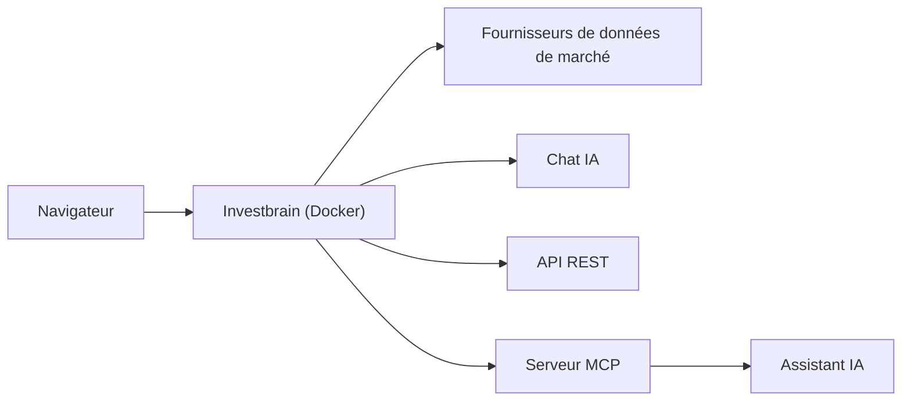

# investbrainapp/investbrain

> Suivi de portefeuille d'investissements open source, avec chat IA et serveur MCP, en cloud ou auto-hébergé.

## Le problème
Suivre ses positions, dividendes et splits oblige à des tableurs ou à des services fermés qui gardent tes données.

## Ce que ça fait vraiment
Investbrain gère portefeuilles, transactions, avoirs, dividendes et splits, avec partage, import/export et API REST. Il propose un chat IA et un serveur MCP pour Claude, ChatGPT, Cursor ou VS Code. On peut s'inscrire sur la version cloud ou l'auto-héberger avec Docker. Le README reste court : le détail est dans la documentation externe.

## Comment c'est branché
Schéma simplifié d'après la fiche, sans diagramme fourni.


## Essayer
```bash
curl -O https://raw.githubusercontent.com/investbrainapp/investbrain/main/docker-compose.yml
docker compose up -d
```
Puis ouvrir `http://localhost:8000/register`.

## Coût et pièges
L'auto-hébergement est gratuit ; la version cloud est une offre séparée. Les fournisseurs de données de marché et le chat IA demandent une configuration (clés) décrite dans la documentation, non reprise dans le README. Licence présente mais non identifiée : à vérifier.

## Ce que ce n'est pas
Ce n'est pas un conseiller financier : c'est un outil de suivi. Le README ne détaille ni la pile technique ni les sources de prix.

## Alternatives
Aucune alternative nommée dans le README.

## Pour toi
À surveiller : sert si tu veux un suivi perso auto-hébergé avec accès MCP ; sans intérêt direct pour un projet data/IA professionnel, licence à vérifier.

