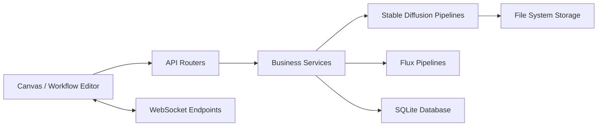

# invoke-ai/InvokeAI

> Local image generation application (Stable Diffusion, FLUX) with a canvas and node-based workflows.

## The problem
Generating and retouching images with recent diffusion models means orchestrating models, pipelines and the interface yourself.

## What it actually does
Local web server (FastAPI + React) with a Unified Canvas (in/out-painting, brushes), a node-based workflow editor and a gallery.
Supports ckpt, diffusers and some gguf; model manager, upscaling, SAM/SAM2.
Asynchronous execution queue, events pushed over WebSocket, persistence in SQLite + files.
Foundation of several of the publisher's commercial products.

## How it is wired

## Trying it
No documented command: the README points to downloading the Launcher.

## Cost and gotchas
Free (Apache-2.0); a compatible GPU is required, and large model weights must be downloaded (HuggingFace).

## What it is not
Not a Python library to integrate into your code: it is an application. The licenses of the models you load (e.g. FLUX dev) remain your responsibility.

## Alternatives
No alternative named in the README.

## For you
Keep an eye on it: a good local creative workshop, but outside the data/MLOps core unless you need image generation for prototypes.
