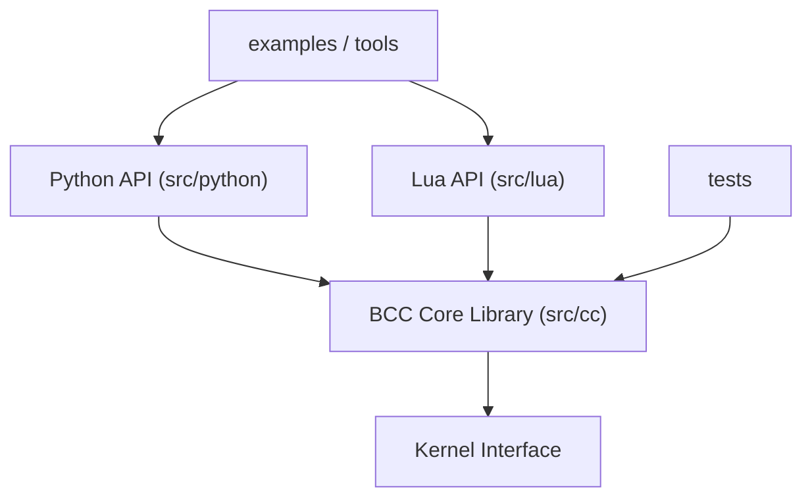

# iovisor/bcc

> Linux kernel tracing toolkit via eBPF, with Python and Lua front ends, for admins and performance work.

## The problem
Writing BPF in raw C is painful and you only learn at runtime whether it is valid. Diagnosing a production Linux system requires safe kernel probes.

## What it actually does
Compiles modified C through LLVM into BPF bytecode and loads it dynamically into the kernel (kprobes, tracepoints, USDT, tc, socket filters). Provides dozens of ready-made tools (`tcpconnect`, `biolatency`, `execsnoop`, `opensnoop`) and examples. Only aggregated histograms are sent back to user space.

## How it is wired


## Trying it
```bash
# Installation : voir INSTALL.md selon la plateforme
./bitehist.py
```

## Cost and gotchas
Linux 4.1 minimum, root rights, kernel with BPF enabled. Distribution-dependent installation (LLVM, kernel headers).

## What it is not
Not a Windows or macOS tool. Not a continuous monitoring agent: these are one-off diagnostic probes. The repository also contains `libbpf-tools`, an auxiliary variant.

## Alternatives
No alternative named in the README.

## For you
Adopt it if you have Linux hosts to diagnose (I/O, network, inference latency): proven tools and a permissive license.
