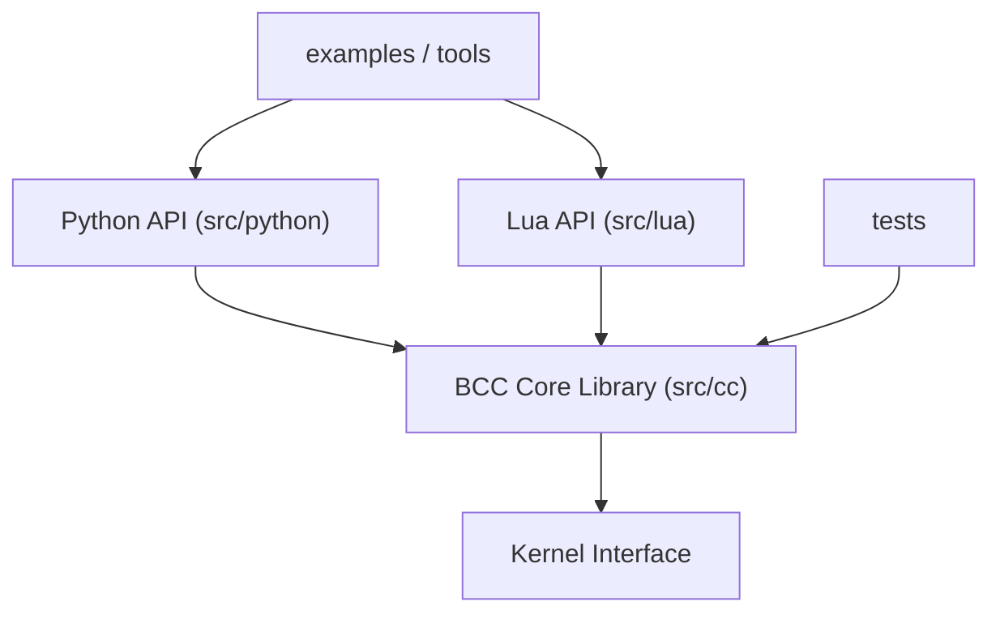

# iovisor/bcc

> Boîte à outils de traçage noyau Linux via eBPF, avec frontaux Python et Lua, pour admins et perfs.

## Le problème
Écrire du BPF en C brut est pénible et on ne sait qu'à l'exécution s'il est valide. Diagnostiquer un système Linux en production demande des sondes noyau sûres.

## Ce que ça fait vraiment
Compile du C modifié via LLVM en bytecode BPF, le charge dynamiquement dans le noyau (kprobes, tracepoints, USDT, tc, filtres socket). Fournit des dizaines d'outils prêts à l'emploi (`tcpconnect`, `biolatency`, `execsnoop`, `opensnoop`) et des exemples. Seuls les histogrammes agrégés remontent en espace utilisateur.

## Comment c'est branché


## Essayer
```bash
# Installation : voir INSTALL.md selon la plateforme
./bitehist.py
```

## Coût et pièges
Linux 4.1 minimum, droits root, noyau avec BPF activé. Installation dépendante de la distribution (LLVM, en-têtes noyau).

## Ce que ce n'est pas
Pas un outil Windows ou macOS. Pas un agent de supervision continue : ce sont des sondes ponctuelles de diagnostic. Le dépôt contient aussi `libbpf-tools`, variante auxiliaire.

## Alternatives
Aucune alternative nommée dans le README.

## Pour toi
Adopter si tu as des hôtes Linux à diagnostiquer (I/O, réseau, latence d'inférence) : outils éprouvés et licence permissive.

