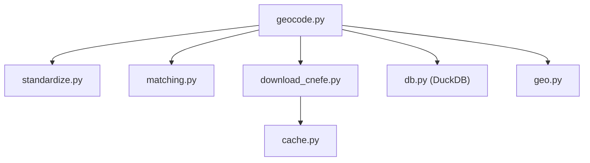

# ipea/geocodebr

> Free R and Python package for unlimited geocoding of Brazilian addresses, based on CNEFE.

## The problem
Common geocoders depend on commercial services with quotas, poorly suited to millions of addresses.

## What it actually does
Three functions: `geocode()` (addresses to coordinates), `geocode_reverso()` (coordinates to nearby addresses) and `busca_por_cep()`. The CNEFE data (IBGE), about 1.2 GB, is downloaded on the first call into a local cache. The Python version uses DuckDB and gives the same function names as R.

## How it is wired
Diagram based on the code.



## Trying it
```bash
python -m pip install geocodebr
python -m pip install "geocodebr[geo]"
# R : install.packages("geocodebr")
```

## Cost and gotchas
Free. Slow first run: 1.2 GB download. License not identified by GitHub. README in Portuguese.

## What it is not
Limited to addresses in Brazil. Not a worldwide geocoder.

## Alternatives
- `tidygeocoder` (R): interface to several geocoding services.
- `geopy` (Python): client for geocoding services (Nominatim, Google, ArcGIS).

## For you
Watch: useful if you process Brazilian addresses in bulk; otherwise irrelevant.
