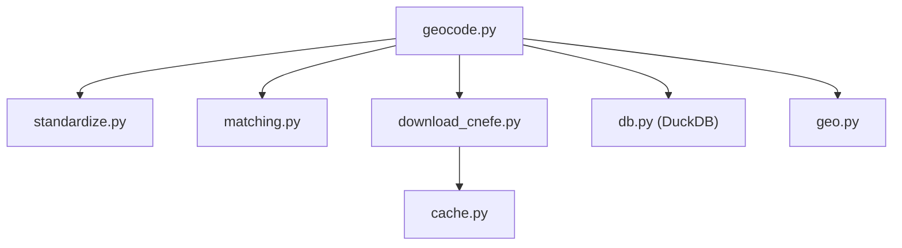

# ipea/geocodebr

> Paquet R et Python de géocodage gratuit et sans limite d'adresses brésiliennes, d'après le CNEFE.

## Le problème
Les géocodeurs courants dépendent de services commerciaux avec quotas, peu adaptés à des millions d'adresses.

## Ce que ça fait vraiment
Trois fonctions : `geocode()` (adresses vers coordonnées), `geocode_reverso()` (coordonnées vers adresses proches) et `busca_por_cep()`. Les données du CNEFE (IBGE), environ 1,2 Go, sont téléchargées au premier appel dans un cache local. La version Python utilise DuckDB et donne les mêmes noms de fonctions que R.

## Comment c'est branché
Schéma d'après le diagramme du code.



## Essayer
```bash
python -m pip install geocodebr
python -m pip install "geocodebr[geo]"
# R : install.packages("geocodebr")
```

## Coût et pièges
Gratuit. Premier lancement lent : téléchargement de 1,2 Go. Licence non identifiée par GitHub. README en portugais.

## Ce que ce n'est pas
Limité aux adresses du Brésil. Pas un géocodeur mondial.

## Alternatives
- `tidygeocoder` (R) : interface vers plusieurs services de géocodage.
- `geopy` (Python) : client de services de géocodage (Nominatim, Google, ArcGIS).

## Pour toi
Surveiller : utile si tu traites des adresses brésiliennes en masse ; sinon sans objet.

