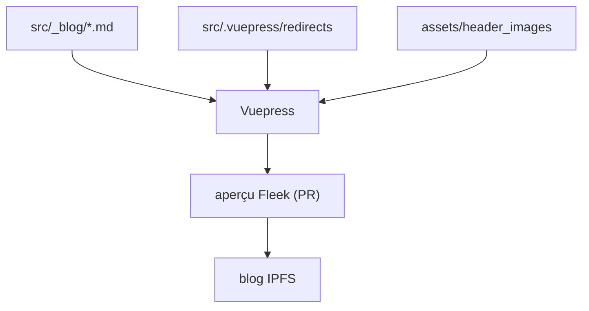

# ipfs/ipfs-blog

> Code and articles of the IPFS blog, built with Vuepress, for site contributors.

## The problem
Publishing articles on the IPFS blog with a pull-request contribution process.

## What it actually does
Each article is a Markdown file in `src/_blog` with a YAML header (title, author, date, tags, image). The Vuepress site is previewed by Fleek on every pull request. Redirects are declared in `src/.vuepress/redirects`. Site development happens on `main`, not on `staging`.

## How it is wired
Simplified diagram based on the sheet, no diagram provided.


## Trying it
```bash
git clone https://github.com/ipfs/ipfs-blog.git
cd ipfs-blog
npm install
npm start
NODE_OPTIONS=--openssl-legacy-provider npm start
```

## Cost and gotchas
With Node 18 or later, the `ERR_OSSL_EVP_UNSUPPORTED` error requires Node 16 or the `--openssl-legacy-provider` option.

## What it is not
Not an IPFS tool: it is the code of a blog site.

## Alternatives
No alternative named in the README.

## For you
Ignore: blog site, no direct value for a data, AI or MLOps profile.
