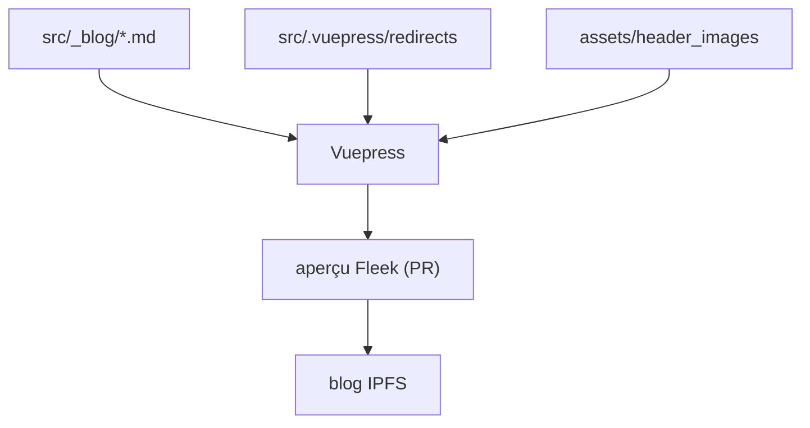

# ipfs/ipfs-blog

> Code et articles du blog IPFS, construit avec Vuepress, pour contributeurs du site.

## Le problème
Publier des articles sur le blog IPFS avec un processus de contribution par pull request.

## Ce que ça fait vraiment
Chaque article est un fichier Markdown dans `src/_blog` avec un en-tête YAML (titre, auteur, date, étiquettes, image). Le site Vuepress est prévisualisé par Fleek à chaque pull request. Les redirections se déclarent dans `src/.vuepress/redirects`. Le développement du site se fait sur `main`, pas sur `staging`.

## Comment c'est branché
Schéma simplifié d'après la fiche, sans diagramme fourni.


## Essayer
```bash
git clone https://github.com/ipfs/ipfs-blog.git
cd ipfs-blog
npm install
npm start
NODE_OPTIONS=--openssl-legacy-provider npm start
```

## Coût et pièges
Avec Node 18 ou plus, l'erreur `ERR_OSSL_EVP_UNSUPPORTED` impose Node 16 ou l'option `--openssl-legacy-provider`.

## Ce que ce n'est pas
Pas un outil IPFS : c'est le code d'un site de blog.

## Alternatives
Aucune alternative nommée dans le README.

## Pour toi
À ignorer : site de blog, sans valeur directe pour un profil data, IA ou MLOps.

