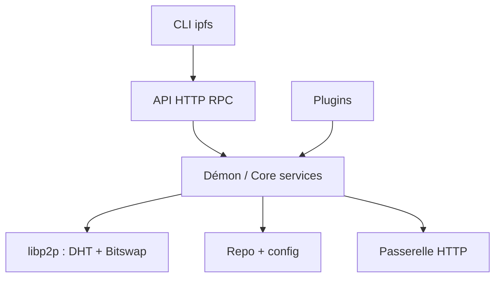

# ipfs/kubo

> Reference Go implementation of IPFS: a content-addressed storage node on a peer-to-peer network.

## The problem
Distributing and verifying files or datasets without a central server, by addressing them by their fingerprint (CID).

## What it actually does
A daemon exposes an IPFS node: Amino DHT on the WAN and mDNS on the LAN, block exchange through Bitswap, HTTP gateway, HTTP RPC API, HTTP Routing V1 client and server, web interface, experimental FUSE mounts, content blocking for public operators. The `ipfs` CLI drives the daemon. A plugin system allows adding datastores.

## How it is wired


## Trying it
```bash
ipfs init --profile=unixfs-v1-2025
ipfs daemon &
echo "hello IPFS" | ipfs add -q
docker run --rm -it --net=host ipfs/kubo:latest
```

## Cost and gotchas
Free, but 6 GB of RAM and 2 cores recommended; about 1 GiB of RAM per 20 million pinned items. Crucial point: the README states that there is no longer a dedicated maintainer and that Shipyard's work ends on 30 September 2026. Third-party distribution packages are not verified by the project.

## What it is not
It is not guaranteed storage: without pinning or peer availability, data can disappear. It is not private by default.

## Alternatives
Helia (JavaScript implementation, cited in the README).

## For you
Keep an eye on it: relevant for distributing datasets or models addressed by hash, but the future of maintenance is uncertain and the license needs checking.
