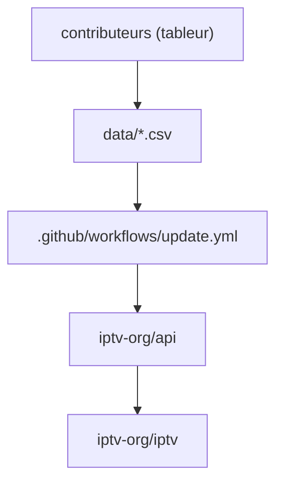

# iptv-org/database

> Editable database of TV channels, stored as CSV and editable in a spreadsheet.

## The problem
Describing thousands of TV channels — name, country, language, category — requires a single
source that non-developer contributors can correct.

## What it actually does
Stores all the data in `/data` as CSV files, editable with any spreadsheet (Google Sheets,
LibreOffice). The same data is exposed through an API, documented in the `iptv-org/api`
repository. A CI workflow (`update.yml`) keeps the repository up to date. It is the source from
which `iptv-org/iptv` draws the metadata for its playlists.

## How it is wired

## Trying it
No command documented in the README: the files in `/data` can be read and edited
directly, and programmatic access goes through the `iptv-org/api` repository.

## Cost and gotchas
Free and dependency-free, but the README is very short: no column schema, no license,
no freshness guarantee. You have to open the CSVs to know what they contain.

## What it is not
It is not a list of streams: no stream URLs here, they are in `iptv-org/iptv`.
It is not an API — it is the store behind it, the API is a separate repository. And it is not
an official registry of broadcasters, only a community database.

## Alternatives
- `iptv-org/api` — if you want to query this data instead of reading CSVs.
- `iptv-org/iptv` — if it is the streams you are after, not the metadata.

## For you
A clean public CSV, fine as a test dataset; no data or MLOps business interest.
