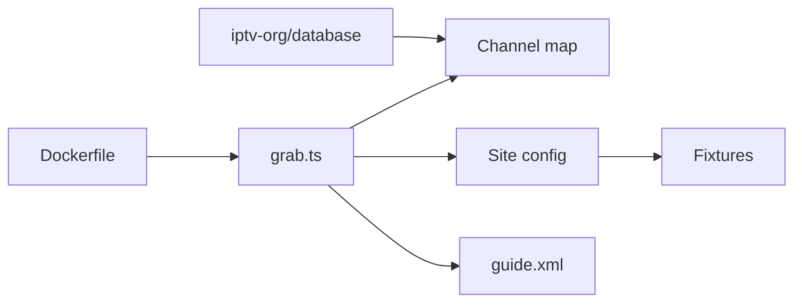

# iptv-org/epg

> Node.js tools that download TV program guides from hundreds of sources in XMLTV format.

## The problem
Program guides are scattered across heterogeneous sites, with no common format.

## What it actually does
The `grab` command reads `*.channels.xml` lists, calls the adapters in `sites/<domain>/` and produces `guide.xml` (and optionally JSON or gzip). Options: languages, delay, proxy, parallel connections, scheduling via cron or timers, Docker image with HTTP service.

## How it is wired


## Trying it
```bash
git clone --depth 1 -b master https://github.com/iptv-org/epg.git
cd epg
npm install
npm run grab --- --sites=example.com
```

## Cost and gotchas
Free; some sites block downloads that are too parallel. Adapters break when a site changes.

## What it is not
Not a TV broadcast stream. Unlicense license (public domain).

## Alternatives
- None cited in the README.

## For you
To ignore: useful for an IPTV player, nothing for a data/AI workflow.
