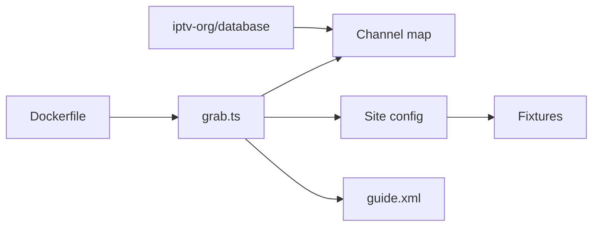

# iptv-org/epg

> Outils Node.js qui téléchargent les guides de programmes TV de centaines de sources au format XMLTV.

## Le problème
Les guides de programmes sont dispersés sur des sites hétérogènes, sans format commun.

## Ce que ça fait vraiment
La commande `grab` lit des listes `*.channels.xml`, appelle les adaptateurs de `sites/<domaine>/` et produit `guide.xml` (et optionnellement JSON ou gzip). Options : langues, délai, proxy, connexions parallèles, planification par cron ou chronos, image Docker avec service HTTP.

## Comment c'est branché


## Essayer
```bash
git clone --depth 1 -b master https://github.com/iptv-org/epg.git
cd epg
npm install
npm run grab --- --sites=example.com
```

## Coût et pièges
Gratuit ; certains sites bloquent les téléchargements trop parallèles. Les adaptateurs cassent quand un site change.

## Ce que ce n'est pas
Pas un flux de diffusion TV. Licence Unlicense (domaine public).

## Alternatives
- Aucune citée dans le README.

## Pour toi
À ignorer : utile pour un lecteur IPTV, rien pour un flux data/IA.

