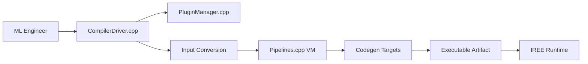

# iree-org/iree

> End-to-end MLIR-based compiler and runtime that compiles ML models for datacenter and mobile.

## The problem
Deploying a model on varied hardware (GPU, CPU, mobile, edge) requires rewriting the execution for each target.

## What it actually does
Takes a model or IR, converts it, applies preprocessing passes, goes through IREE phases, generates code for the target (including SPIR-V) and produces an executable artifact that the runtime loads and sends to the hardware. Input plugins and executable plugins. Distributed as the PyPI packages `iree-base-compiler` and `iree-base-runtime`.

## How it is wired

## Trying it
No command in the README: guides on the iree.dev site.

## Cost and gotchas
Free. Getting started is not described here. 1,730 open issues: active project but in motion.

## What it is not
Not a training framework nor a simple converter. The README is mostly a dashboard (statuses, talks): few explanations.

## Alternatives
No alternative named in the README.

## For you
Watch: relevant for deploying models on heterogeneous hardware; too low-level if you stay on PyTorch and a classic GPU server.
