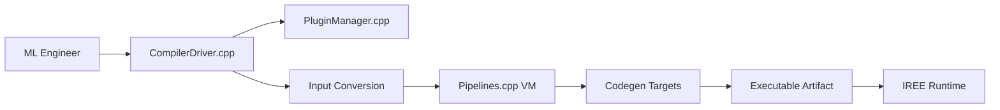

# iree-org/iree

> Compilateur et runtime de bout en bout basé sur MLIR, qui compile des modèles ML vers datacenter et mobile.

## Le problème
Déployer un modèle sur des matériels variés (GPU, CPU, mobile, edge) impose de réécrire l'exécution pour chaque cible.

## Ce que ça fait vraiment
Reçoit un modèle ou de l'IR, le convertit, applique des passes de prétraitement, passe par des phases IREE, génère du code pour la cible (dont SPIR-V) et produit un artefact exécutable que le runtime charge et envoie au matériel. Plugins d'entrée et plugins exécutables. Distribué comme paquets PyPI `iree-base-compiler` et `iree-base-runtime`.

## Comment c'est branché

## Essayer
Aucune commande dans le README : guides sur le site iree.dev.

## Coût et pièges
Gratuit. Prise en main non décrite ici. 1 730 issues ouvertes : projet actif mais en mouvement.

## Ce que ce n'est pas
Pas un framework d'entraînement ni un simple convertisseur. Le README est surtout un tableau de bord (statuts, talks) : peu d'explications.

## Alternatives
Aucune alternative nommée dans le README.

## Pour toi
Surveiller : pertinent pour déployer des modèles sur matériel hétérogène ; trop bas niveau si tu restes sur PyTorch et un serveur GPU classique.

