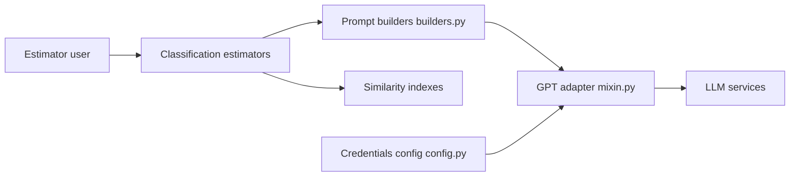

# iryna-kondr/scikit-llm

> scikit-learn-style estimators that call LLMs to classify, summarize or vectorize text.

## The problem
Using an LLM for text classification forces you to write prompts, API calls and parsing, outside the usual scikit-learn fit/predict flow.

## What it actually does
`fit` / `predict` estimators for zero-shot and few-shot classification, entity tagging, summarization, translation and vectorization. GPT, Anthropic and Vertex adapters; few-shot can look up neighboring examples in an in-memory index. Prompts are built by internal builders and templates.

## How it is wired


## Trying it
```bash
pip install scikit-llm
```
```python
from skllm.config import SKLLMConfig
from skllm.models.gpt.classification.zero_shot import ZeroShotGPTClassifier
SKLLMConfig.set_openai_key("<YOUR_KEY>")
clf = ZeroShotGPTClassifier(model="gpt-4")
clf.fit(X, y)
clf.predict(X)
```

## Cost and gotchas
Each prediction calls the provider's API: the bill is at your expense, proportional to volume. Minimal README, the detail is in the external documentation.

## What it is not
Not a local or trained classifier: it is an LLM call disguised as an estimator, with latency and cost per row.

## Alternatives
No alternative named in the README.

## For you
Adopt to quickly prototype zero-shot text classification in a scikit-learn pipeline; keep an eye on cost at volume.
