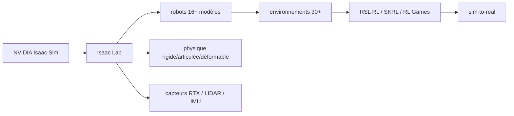

# isaac-sim/IsaacLab

> Open-source GPU framework for robotics research: RL, imitation, motion planning.

## The problem
Training a robot policy in simulation requires assembling physics, sensors and environments, and transfer to the real world fails if the simulation is not faithful.

## What it actually does
Unifies robotics research workflows — reinforcement learning, imitation, planning — on NVIDIA Isaac Sim.
More than 16 robot models: manipulators, quadrupeds, humanoids.
More than 30 ready-to-train environments, compatible with RSL RL, SKRL, RL Games and Stable Baselines, multi-agent included.
Simulated sensors: RTX RGB cameras, depth and segmentation, LIDAR, IMU, contact sensors, ray casters. Rigid bodies, articulated systems, deformable objects.

## How it is wired

## Trying it
No command is documented in the README: it points to the Isaac Lab documentation for installation.

## Cost and gotchas
Free but inseparable from Isaac Sim, an NVIDIA product, and a GPU. Version coupling is strict: the `release/3.0.0` branch requires Isaac Sim 6.1, `main` covers 4.5, 5.0 and 5.1 — picking the wrong branch does not work.

## What it is not
Not stable on this branch: the README warns that `release/3.0.0` is under active development, with possible breaking changes, error messages and performance regressions. Not standalone: without Isaac Sim, nothing runs. Not a tool for deploying to a real robot, only for training in simulation.

## Alternatives
RSL RL, SKRL, RL Games, Stable Baselines — the supported RL frameworks, not substitutes for Isaac Lab.

## For you
Worth watching if you work on robotics RL; being tied to Isaac Sim and an NVIDIA GPU makes it a commitment, not a trial.
