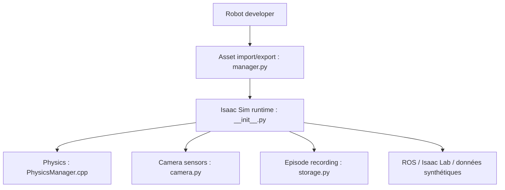

# isaac-sim/IsaacSim

> NVIDIA's Omniverse-based robotics simulation platform for developing, testing and training robots.

## The problem
Training and testing robots requires realistic simulated environments with sensors and physics.

## What it actually does
Imports robots (URDF, MJCF, CAD), simulates physics on GPU, provides RTX and physics sensors, controllers and motion generation. Integrates with ROS, Isaac Lab (RL, imitation), synthetic data generation and digital twins. The repository describes building from source.

## How it is wired


## Trying it
```bash
git clone -b main https://github.com/isaac-sim/IsaacSim.git isaacsim
cd isaacsim
git lfs install && git lfs pull
./build.sh
cd _build/linux-x86_64/release && ./isaac-sim.sh
```

## Cost and gotchas
A recent NVIDIA RTX GPU is required (RTX 4080 minimum). GCC/G++ 11 required; Internet access to download Kit. Long first launch. License present but unidentified, acceptance of the Omniverse terms at first build.

## What it is not
Not a lightweight simulator: heavy on hardware and NVIDIA dependencies.

## Alternatives
- Isaac Lab: RL/imitation framework built on Isaac Sim, cited by the README.

## For you
Worth watching: relevant for robotics, RL and synthetic data if you have an NVIDIA RTX GPU; too heavy otherwise.
