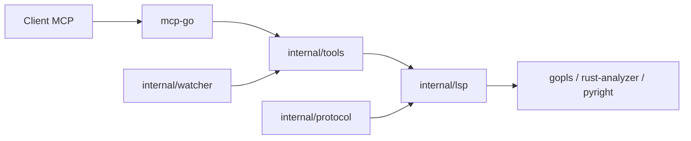

# isaacphi/mcp-language-server

> MCP server that exposes a language server (LSP) to LLMs: definitions, references, rename, diagnostics.

## The problem
A coding agent that navigates by text search misses meaning: it does not know where a symbol is defined or who uses it.

## What it actually does
A Go binary launched with `--workspace` and `--lsp <server>` starts a real language server (gopls, rust-analyzer, pyright, typescript-language-server, clangd) and translates its responses into MCP tools: `definition`, `references`, `diagnostics`, `hover`, `rename_symbol`, `edit_file`. The generated LSP code is taken from gopls.

## How it is wired


## Trying it
```bash
go install github.com/isaacphi/mcp-language-server@latest
# puis, dans la config du client MCP :
# "command": "mcp-language-server",
# "args": ["--workspace", "/Users/you/dev/yourproject/", "--lsp", "gopls"]
```

## Cost and gotchas
Free. You need Go and a language server installed for each language, with the right `PATH` and environment variables in the client config. `LOG_LEVEL=DEBUG` to diagnose.

## What it is not
Not a language server for MCP, the README specifies. Beta software by the author's own admission. `edit_file` actually modifies your files by line numbers.

## Alternatives
No alternative named in the README.

## For you
Worth watching: useful to give a coding agent semantic navigation on Python (pyright), but beta and maintained by a single person.
