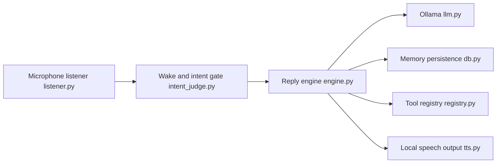

# isair/jarvis

> Local voice assistant with personal memory, tools and chat, for those who want an assistant without the cloud.

## The problem
Voice assistants send your conversations to the cloud and forget everything from one session to the next.

## What it actually does
A desktop application that listens continuously, detects when it is being addressed (name, intent), transcribes with Whisper, reasons via Ollama or an OpenAI-compatible server, and replies with Piper. Local memory (journal, knowledge graph), built-in tools (web search, weather, files, screen OCR), MCP servers and push-to-talk dictation. Sensitive data is masked before reaching the model or the journal.

## How it is wired


## Trying it
```bash
git clone https://github.com/isair/jarvis.git
cd jarvis
bash scripts/run_macos.sh
bash scripts/run_linux.sh
```

## Cost and gotchas
Free, no subscription. RAM or VRAM depends on the model (from `qwen3.5:0.8b` to 27B) plus Whisper. Web search, MCP and location detection use the network unless you disable them. Dictation unavailable on macOS 26+.

## What it is not
Not a mature product: developed mostly on macOS, Windows and Linux may differ, no mobile app. The word "stop" can be confused with echo. The license is present but not identified by GitHub.

## Alternatives
No alternative named in the README.

## For you
Watch: a serious demonstrator of a local assistant, but the license needing clarification and the dependence on your hardware limit professional use.
