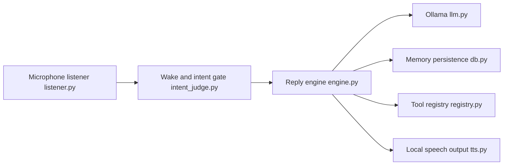

# isair/jarvis

> Assistant vocal local avec mémoire personnelle, outils et chat, pour qui veut un assistant sans cloud.

## Le problème
Les assistants vocaux envoient tes conversations dans le cloud et oublient d'une session à l'autre.

## Ce que ça fait vraiment
Application de bureau qui écoute en continu, détecte quand on s'adresse à elle (nom, intention), transcrit avec Whisper, raisonne via Ollama ou un serveur compatible OpenAI, et répond avec Piper. Mémoire locale (journal, graphe de connaissances), outils intégrés (recherche web, météo, fichiers, OCR d'écran), serveurs MCP et dictée par raccourci. Les données sensibles sont masquées avant d'atteindre le modèle ou le journal.

## Comment c'est branché


## Essayer
```bash
git clone https://github.com/isair/jarvis.git
cd jarvis
bash scripts/run_macos.sh
bash scripts/run_linux.sh
```

## Coût et pièges
Gratuit, sans abonnement. La RAM ou la VRAM dépend du modèle (de `qwen3.5:0.8b` à 27B) plus Whisper. Recherche web, MCP et détection de lieu utilisent le réseau, sauf si tu les désactives. Dictée indisponible sur macOS 26+.

## Ce que ce n'est pas
Pas un produit mature : développé surtout sur macOS, Windows et Linux peuvent différer, pas d'application mobile. Le mot « stop » peut être confondu avec de l'écho. La licence est présente mais non identifiée par GitHub.

## Alternatives
Aucune alternative nommée dans le README.

## Pour toi
À surveiller : démonstrateur sérieux d'assistant local, mais la licence à clarifier et la dépendance à ton matériel limitent un usage pro.

