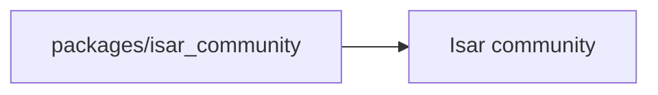

# isar-community/isar-community

> Fork communautaire d'Isar, base de données locale pour applications Flutter ; le README fourni est vide.

## Le problème
Non documenté dans la matière fournie : le README n'a aucun contenu exploitable.

## Ce que ça fait vraiment
Non documenté. Seuls le chemin `packages/isar_community/README.md`, la licence Apache-2.0, 196 étoiles et un dernier push au 2026-10-14 sont connus.

## Comment c'est branché
Schéma simplifié d'après la fiche, sans diagramme fourni.

## Essayer
Aucune commande documentée.

## Coût et pièges
Matière insuffisante : coût, prérequis et mode d'installation sont inconnus. 45 issues ouvertes.

## Ce que ce n'est pas
Pas une fiche vérifiable : rien n'est confirmé sur le périmètre réel, au-delà du nom du dépôt.

## Alternatives
Aucune alternative nommée dans le README.

## Pour toi
À ignorer : aucune matière pour juger, et une base locale Flutter n'est pas ton cœur de métier data / IA / MLOps.

