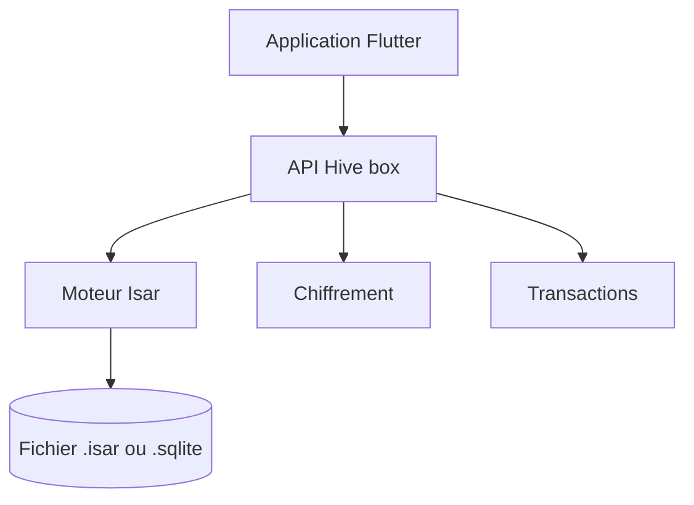

# isar/hive

> Lightweight key-value database for Flutter and Dart, for storing local data on mobile, desktop and web.

## The problem
Flutter applications need simple, fast, encryptable local storage without writing SQL.

## What it actually does
Offers persistent key-value "boxes" usable as a map or list, typed, with atomic transactions, per-page AES 256 encryption, multi-isolate support (`Hive.compute()`) and adapters for objects via `fromJson` and `toJson`. The README states that Hive is a thin wrapper around Isar.

## How it is wired
Simplified diagram based on the write-up, no diagram provided.



## Trying it
```dart
final dir = await getApplicationDocumentsDirectory();
Hive.defaultDirectory = dir.path;
final box = Hive.box();
box.put('name', 'David');
final name = box.get('name');
```

## Cost and gotchas
Free. Add `hive`, `isar_flutter_libs` and `path_provider` to `pubspec.yaml`. Each box is a file: avoid creating too many. Images go outside the database.

## What it is not
It is not a database with queries or relations. Last push in June 2024 and 569 open tickets: weak maintenance.

## Alternatives
Isar: for queries, relations and advanced features, according to the README.

## For you
Ignore: a Flutter database outside your domain, and poorly maintained since June 2024.
