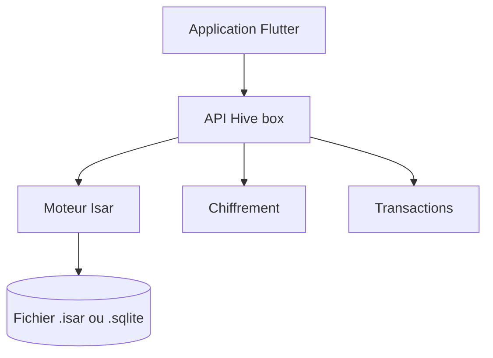

# isar/hive

> Base clé-valeur légère pour Flutter et Dart, pour stocker des données locales sur mobile, bureau et web.

## Le problème
Les applications Flutter ont besoin d'un stockage local simple, rapide et chiffrable sans écrire de SQL.

## Ce que ça fait vraiment
Offre des « boxes » clé-valeur persistantes utilisables comme map ou liste, typées, avec transactions atomiques, chiffrement AES 256 par page, multi-isolates (`Hive.compute()`) et adaptateurs pour objets via `fromJson` et `toJson`. Le README précise que Hive est un fin enrobage autour d'Isar.

## Comment c'est branché
Schéma simplifié d'après la fiche, sans diagramme fourni.



## Essayer
```dart
final dir = await getApplicationDocumentsDirectory();
Hive.defaultDirectory = dir.path;
final box = Hive.box();
box.put('name', 'David');
final name = box.get('name');
```

## Coût et pièges
Gratuit. Ajouter `hive`, `isar_flutter_libs` et `path_provider` au `pubspec.yaml`. Chaque box est un fichier : éviter d'en multiplier. Les images vont hors base.

## Ce que ce n'est pas
Ce n'est pas une base avec requêtes ni relations. Dernier push en juin 2024 et 569 tickets ouverts : maintenance faible.

## Alternatives
Isar : pour les requêtes, relations et fonctions avancées, selon le README.

## Pour toi
Ignorer : base Flutter hors de ton domaine, et peu maintenue depuis juin 2024.

