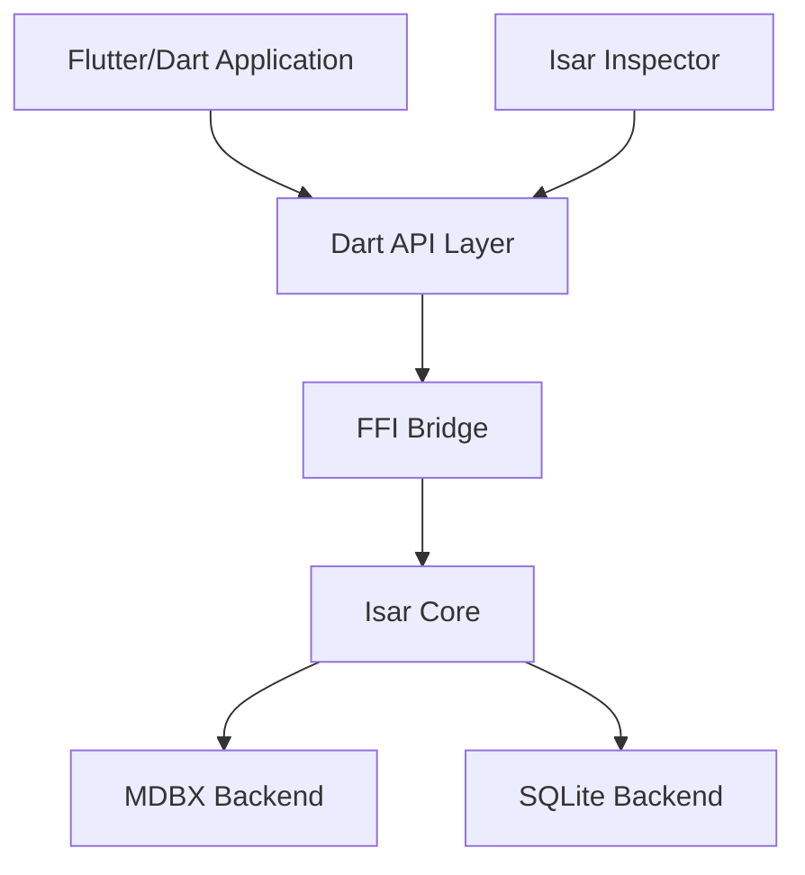

# isar/isar

> Embedded database for Flutter and Dart, based on the architecture diagram.

## The problem
The provided README contains only a file path: the problem addressed is not described there. From the architecture, a Flutter application needs a fast local database.

## What it actually does
Not documented in the README. The architecture described from the code indicates a Dart API, an FFI bridge to a Rust core, collections, a query builder, transactions and watchers, with MDBX storage natively and SQLite for the web, plus an inspection tool.

## How it is wired

## Trying it
No command documented in the provided README.

## Cost and gotchas
Free. The last push dates from June 2025 and 185 issues are open. The provided README gives no cost details.

## What it is not
It is not a data or AI tool. The provided README is almost empty: features and maturity cannot be verified here.

## Alternatives
No alternative named in the README.

## For you
Ignore: Flutter mobile database unrelated to data / AI, and a low-activity repository judging by the last push date.
