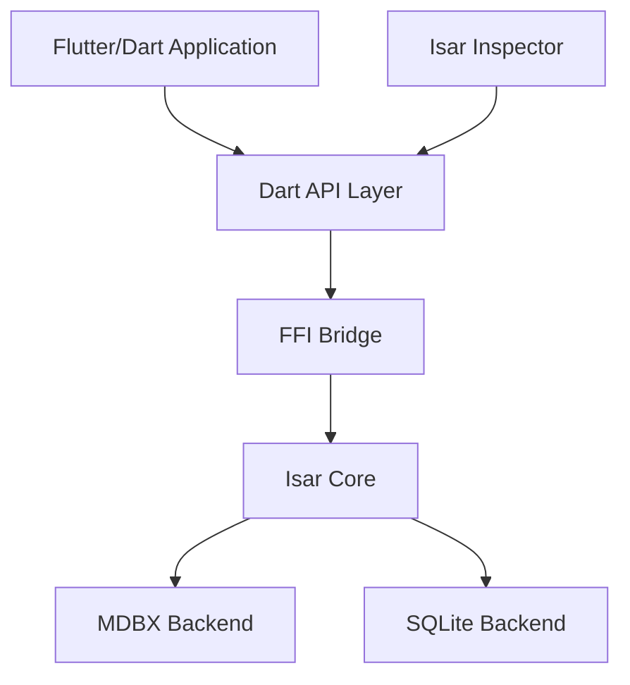

# isar/isar

> Base de données embarquée pour Flutter et Dart, d'après le diagramme d'architecture.

## Le problème
Le README fourni ne contient qu'un chemin de fichier : le problème traité n'y est pas décrit. D'après l'architecture, une application Flutter a besoin d'une base locale rapide.

## Ce que ça fait vraiment
Non documenté dans le README. L'architecture décrite d'après le code indique une API Dart, un pont FFI vers un cœur Rust, des collections, un constructeur de requêtes, des transactions et des observateurs, avec un stockage MDBX en natif et SQLite pour le web, plus un outil d'inspection.

## Comment c'est branché

## Essayer
Aucune commande documentée dans le README fourni.

## Coût et pièges
Gratuit. Le dernier push remonte à juin 2025 et 185 issues sont ouvertes. Le README fourni ne donne aucun détail de coût.

## Ce que ce n'est pas
Ce n'est pas un outil data ou IA. Le README fourni est quasi vide : les fonctions et la maturité ne sont pas vérifiables ici.

## Alternatives
Aucune alternative nommée dans le README.

## Pour toi
À ignorer : base mobile Flutter sans lien avec data / IA, et dépôt peu actif d'après la date du dernier push.

