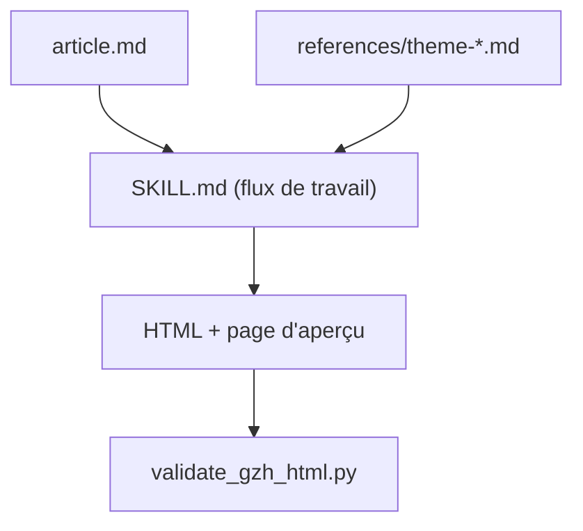

# isjiamu/gzh-design-skill

> Agent skill that turns a Markdown article into HTML that can be pasted into the WeChat Official Accounts editor.

## The problem
The WeChat Official Accounts editor strips many styles on paste. Formatting a long article by hand takes time.

## What it actually does
From a Markdown file, the agent assembles HTML with all-inline styles following one of six provided themes, numbers the sections, underlines keywords and adds an intro card and a table of contents. Two Python scripts check the result: component_lint.py on the components and validate_gzh_html.py on the final HTML. A theme generator creates a style from a description or an image. A preview page offers a copy button.

## How it is wired
Simplified diagram based on the fiche, no diagram provided.


## Trying it
```bash
npx skills add https://github.com/isjiamu/gzh-design-skill
git clone https://github.com/isjiamu/gzh-design-skill.git ~/.claude/skills/gzh-design
python3 scripts/component_lint.py .
python3 scripts/validate_gzh_html.py out.html
```

## Cost and gotchas
Free, but you need a compatible agent (Claude Code, Codex, Cursor). The model consumes your tokens. README in Chinese.

## What it is not
It is not a writer: it only formats text that is already written. It only serves WeChat, not web pages or presentations.

## Alternatives
No alternative named in the README.

## For you
Ignore: it only serves publishing on WeChat, which has nothing to do with your data / AI / MLOps work.
