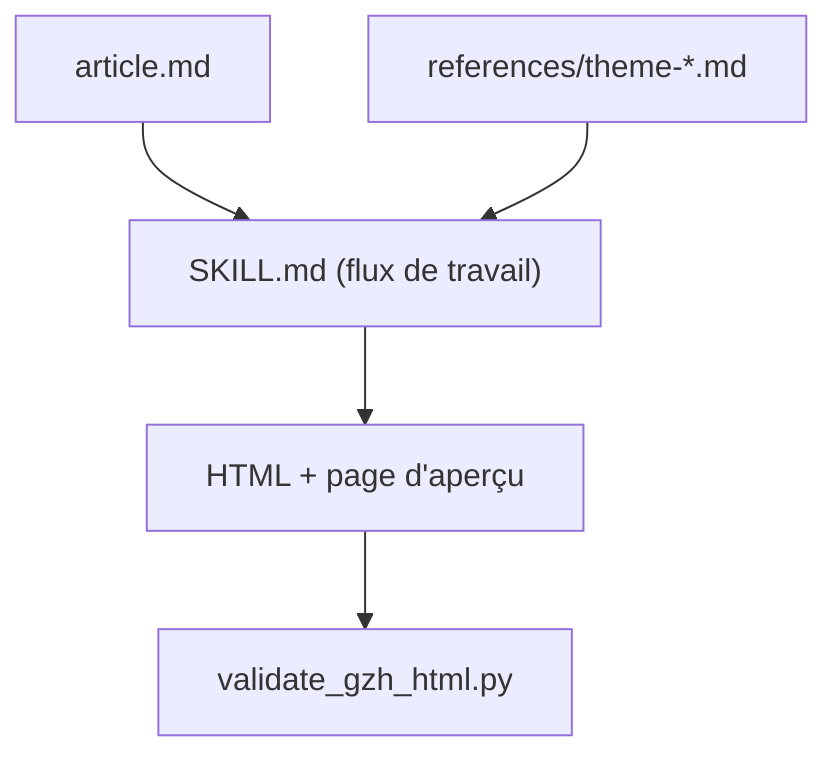

# isjiamu/gzh-design-skill

> Skill d'agent qui transforme un article Markdown en HTML collable dans l'éditeur WeChat Official Accounts.

## Le problème
L'éditeur des comptes publics WeChat supprime beaucoup de styles à la collage. Mettre en forme un long article à la main prend du temps.

## Ce que ça fait vraiment
À partir d'un Markdown, l'agent assemble du HTML à styles tous en ligne selon l'un des six thèmes fournis, numérote les sections, souligne les mots-clés et ajoute carte d'introduction et sommaire. Deux scripts Python contrôlent le résultat : component_lint.py sur les composants et validate_gzh_html.py sur le HTML final. Un générateur de thèmes crée un style depuis une description ou une image. Une page d'aperçu offre un bouton de copie.

## Comment c'est branché
Schéma simplifié d'après la fiche, sans diagramme fourni.


## Essayer
```bash
npx skills add https://github.com/isjiamu/gzh-design-skill
git clone https://github.com/isjiamu/gzh-design-skill.git ~/.claude/skills/gzh-design
python3 scripts/component_lint.py .
python3 scripts/validate_gzh_html.py out.html
```

## Coût et pièges
Gratuit, mais il faut un agent compatible (Claude Code, Codex, Cursor). Le modèle consomme tes jetons. README en chinois.

## Ce que ce n'est pas
Ce n'est pas un rédacteur : il ne met en forme que du texte déjà écrit. Il ne sert qu'à WeChat, pas aux pages web ni aux présentations.

## Alternatives
Aucune alternative nommée dans le README.

## Pour toi
Ignorer : il ne sert qu'à publier sur WeChat, ce qui n'a aucun rapport avec ton travail data / IA / MLOps.

