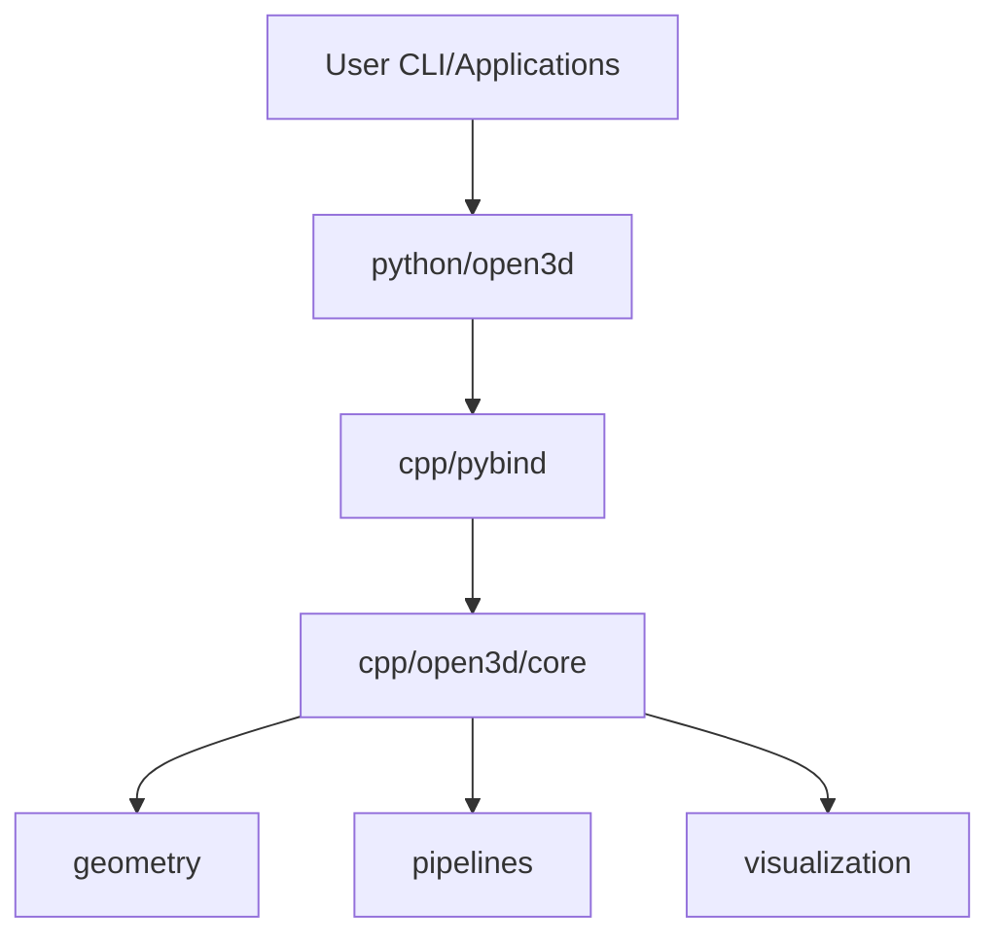

# isl-org/Open3D

> C++ and Python library to process, reconstruct and visualize 3D data, with ML support.

## The problem
Processing 3D point clouds and meshes, aligning and visualizing them requires assembling many libraries.

## What it actually does
3D data structures, processing algorithms, scene reconstruction, surface alignment, visualization and physically based rendering (PBR), GPU acceleration for basic operations. Open3D-ML extension for PyTorch and TensorFlow. An Open3D-Viewer application is provided. Published artifacts carry SLSA provenance attestations.

## How it is wired


## Trying it
```bash
pip install open3d
python -c "import open3d as o3d; print(o3d.__version__)"
open3d example visualization/draw
```

## Cost and gotchas
Free. Python 3.10 to 3.14; the `open3d-cpu` variant is lighter on Linux x86_64. GPU is optional.

## What it is not
Not a deep learning framework: the ML part is a separate extension. The license is not identified by GitHub.

## Alternatives
No alternative named in the README.

## For you
Adopt it if you do 3D vision, robotics or lidar: installation via pip, but confirm the license.
