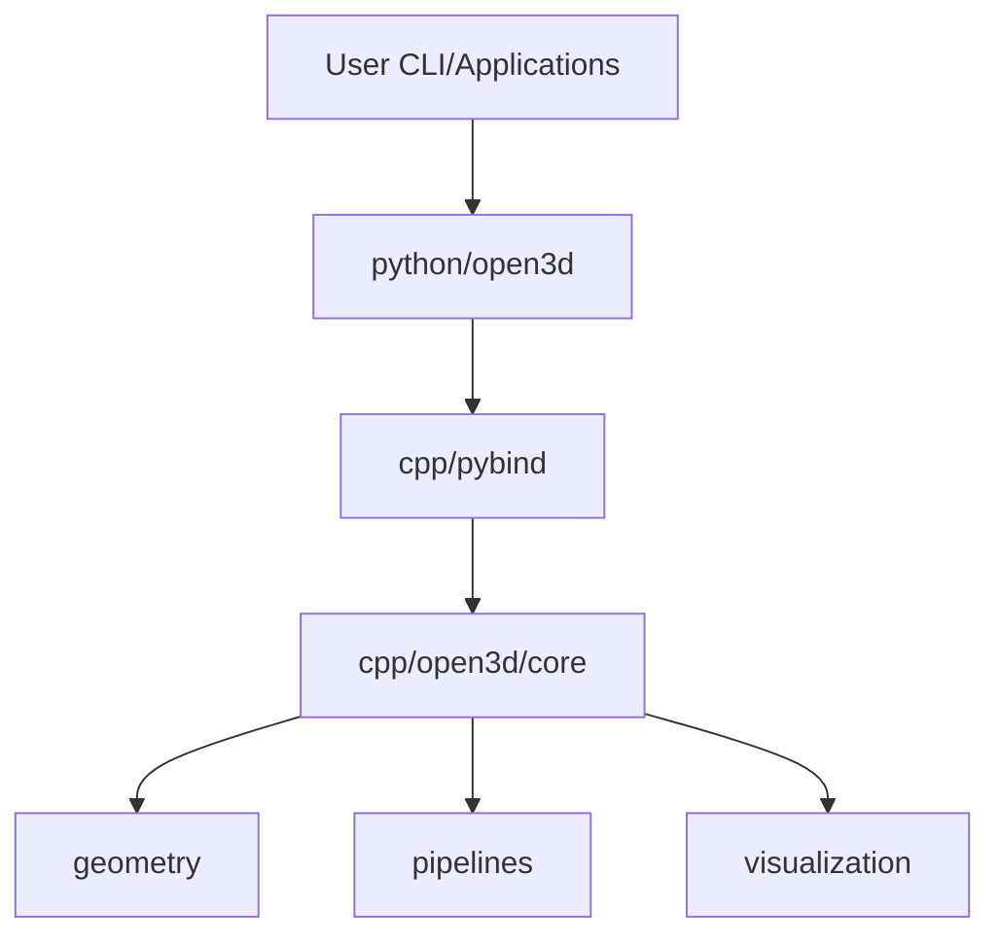

# isl-org/Open3D

> Bibliothèque C++ et Python pour traiter, reconstruire et visualiser des données 3D, avec support ML.

## Le problème
Traiter nuages de points et maillages 3D, les aligner et les visualiser demande d'assembler beaucoup de bibliothèques.

## Ce que ça fait vraiment
Structures de données 3D, algorithmes de traitement, reconstruction de scène, alignement de surfaces, visualisation et rendu physique (PBR), accélération GPU pour les opérations de base. Extension Open3D-ML pour PyTorch et TensorFlow. Une application Open3D-Viewer est fournie. Les artefacts publiés portent des attestations de provenance SLSA.

## Comment c'est branché


## Essayer
```bash
pip install open3d
python -c "import open3d as o3d; print(o3d.__version__)"
open3d example visualization/draw
```

## Coût et pièges
Gratuit. Python 3.10 à 3.14 ; la variante `open3d-cpu` est plus légère sur Linux x86_64. Le GPU est optionnel.

## Ce que ce n'est pas
Pas un framework de deep learning : la partie ML est une extension séparée. La licence n'est pas identifiée par GitHub.

## Alternatives
Aucune alternative nommée dans le README.

## Pour toi
À adopter si tu fais de la vision 3D, de la robotique ou du lidar : installation par pip, mais confirme la licence.

