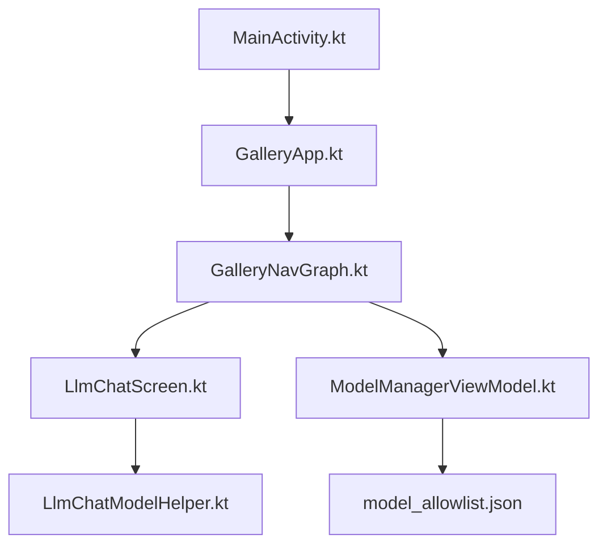

# israel-ivase/Google-AI-Edge-Gallery

> Android application to try local generative models, offline, with images, chat and prompts.

## The problem
Testing small language models on a phone, without the cloud, requires an application that downloads and runs the model.

## What it actually does
The application offers Ask Image, Prompt Lab and AI Chat, with a choice of Hugging Face models, measurements (TTFT, decoding speed, latency) and the ability to add your own LiteRT `.task` models. The code reads a model allowlist and downloads through a worker.

## How it is wired
Diagram based on the code's diagram.

## Trying it
No documented command. The README asks you to download the APK of the latest release and points to the wiki.

## Cost and gotchas
Free. Models are downloaded from Hugging Face and are heavy. The repository looks like a copy: last push in June 2025, alpha version announced by the README.

## What it is not
It is not Google's official repository: the owner is an individual. iOS is announced as "coming soon".

## Alternatives
No alternative named in the README.

## For you
Worth watching: a good demonstration of on-device AI, but prefer the original repository over this copy.
