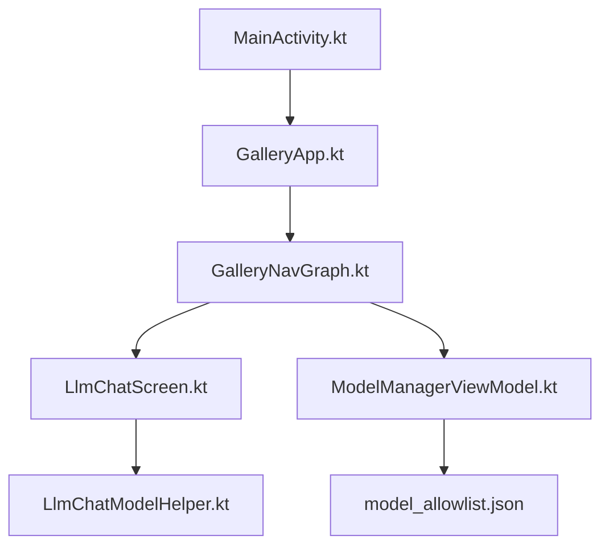

# israel-ivase/Google-AI-Edge-Gallery

> Application Android pour essayer des modèles génératifs locaux, hors ligne, avec images, chat et prompts.

## Le problème
Tester des petits modèles de langage sur un téléphone, sans cloud, demande une application qui télécharge et exécute le modèle.

## Ce que ça fait vraiment
L'application propose Ask Image, Prompt Lab et AI Chat, avec choix de modèles Hugging Face, mesures (TTFT, vitesse de décodage, latence) et ajout de ses propres modèles LiteRT `.task`. Le code lit une liste blanche de modèles et télécharge via un worker.

## Comment c'est branché
Schéma d'après le diagramme du code.

## Essayer
Aucune commande documentée. Le README demande de télécharger l'APK de la dernière version et renvoie au wiki.

## Coût et pièges
Gratuit. Les modèles se téléchargent depuis Hugging Face et pèsent lourd. Le dépôt semble une copie : dernier push en juin 2025, version alpha annoncée par le README.

## Ce que ce n'est pas
Ce n'est pas le dépôt officiel de Google : le propriétaire est un particulier. iOS est annoncé « bientôt ».

## Alternatives
Aucune alternative nommée dans le README.

## Pour toi
À surveiller : bonne démonstration d'IA embarquée, mais préférer le dépôt d'origine à cette copie.

