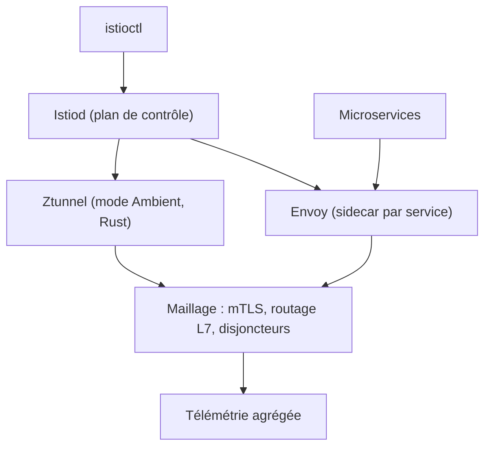

# istio/istio

> Service mesh that secures, connects and observes microservices without touching their code.

## The problem
Mutual encryption, load balancing, policies and telemetry otherwise end up reimplemented
in each service, in each language, with diverging behaviors.

## What it actually does
Adds an abstraction layer on top of the cluster manager, typically Kubernetes,
to manage traffic between microservices, enforce policies and aggregate telemetry.
Three components: **Envoy**, a sidecar proxy per microservice that handles ingress and egress and
provides discovery, layer-7 routing, circuit breakers, policy enforcement and telemetry;
**Ztunnel**, a lightweight data-plane proxy in Rust used in Ambient mode, without sidecar;
**Istiod**, the control plane that handles service discovery, configuration and certificate
management.

## How it is wired


## Trying it
```bash
# Aucune commande dans le README : il renvoie à istio.io et au guide du développeur.
```

## Cost and gotchas
Free. The real cost is operational: a Kubernetes cluster, a sidecar per pod (or Ambient
mode to avoid it), and a wide configuration surface. The README warns that only
`istio/api` and `istio/client-go` expose stable interfaces usable as libraries.

## What it is not
Not an overlay network: it simplifies communication on the existing network, it does not
replace it. Not a single repository: the project is spread across istio/api, istio/proxy,
istio/ztunnel, istio/client-go. Not a single-application tool.

## Alternatives
No alternative named in the README.

## For you
Out of scope unless you yourself operate the clusters that serve your models.
