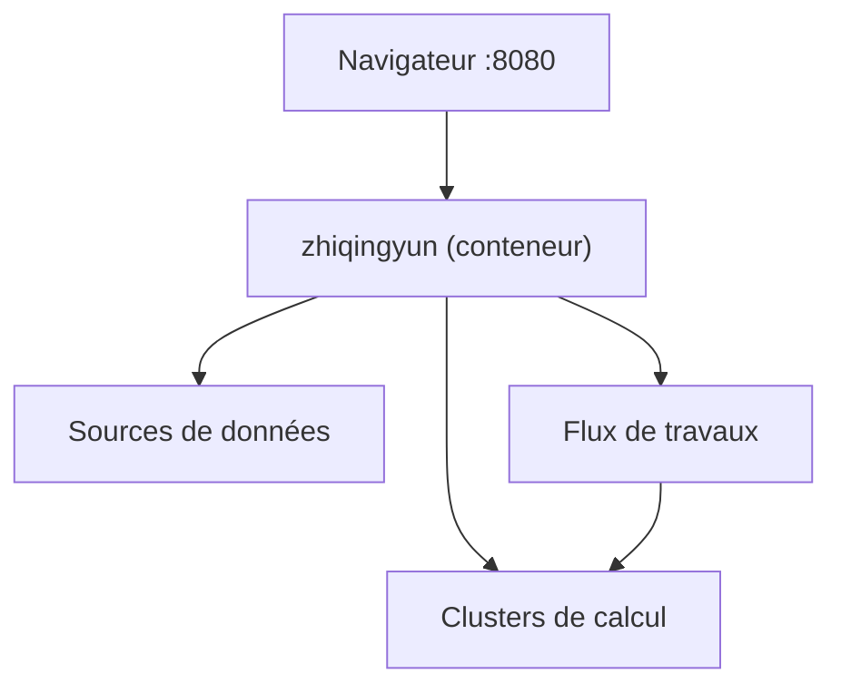

# isxcode/spark-yun

> Chinese data platform (Spark, Flink, Hive...) deployable in a single container, limited free edition.

## The problem
Companies assemble compute clusters, scheduling and data governance; this product groups them in one interface.

## What it actually does
- Free edition: clusters, data sources, drivers, job flows, functions, scheduling monitoring, users and tenants.
- Paid edition: natural-language questions, MCP, quality, security, catalog, API services, dashboards.
- SaaS hosting also offered by the vendor.
- README and website in Chinese.

## How it is wired
Simplified diagram based on the sheet, no diagram provided.


## Trying it
```bash
docker run -p 8080:8080 -d isxcode/zhiqingyun
# http://localhost:8080, compte admin / admin123
```
Source: `docker run --rm -v /tmp/spark-yun:/spark-yun -it isxcode/zhiqingyun-build gradle package`.

## Cost and gotchas
Free edition at no cost, advanced features paid. The default password `admin123` must be changed. Documentation in Chinese; paid-edition prices are not published in the README.

## What it is not
Not a fully open-source tool: the AI and governance features are reserved for the paid offer. Not a compute framework: it drives Spark or Flink.

## Alternatives
No alternative mentioned in the README.

## For you
Ignore: Chinese-only documentation and features useful to an AI profile (MCP, natural-language questions) behind a paid offer.
