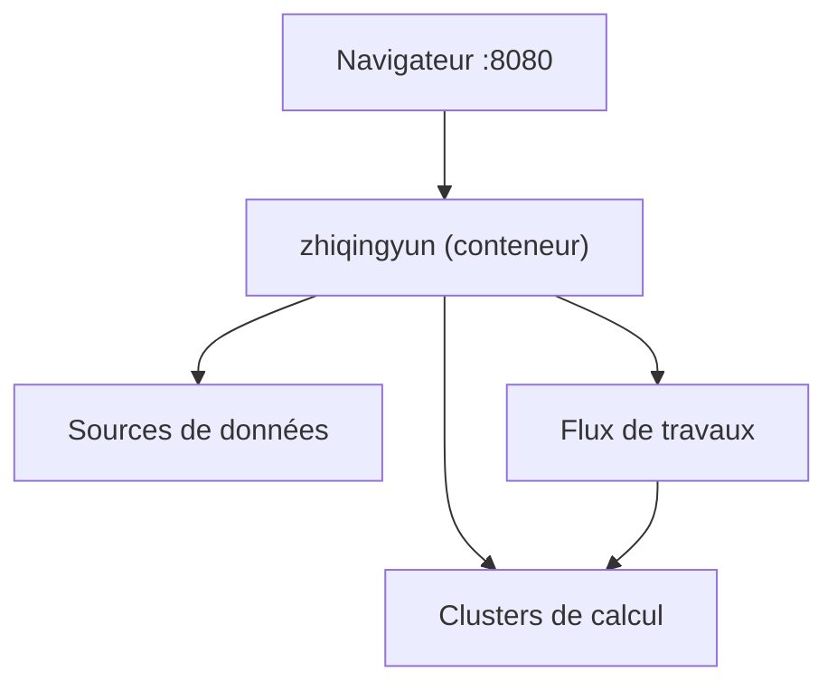

# isxcode/spark-yun

> Plateforme chinoise de données (Spark, Flink, Hive...) déployable en un conteneur, édition libre limitée.

## Le problème
Les entreprises assemblent clusters de calcul, ordonnancement et gouvernance de données ; ce produit les regroupe dans une interface.

## Ce que ça fait vraiment
- Édition libre : clusters, sources de données, pilotes, flux de travaux, fonctions, suivi de l'ordonnancement, utilisateurs et locataires.
- Édition payante : questions en langage naturel, MCP, qualité, sécurité, catalogue, services d'API, tableaux de bord.
- Hébergement SaaS aussi proposé par l'éditeur.
- README et site en chinois.

## Comment c'est branché
Schéma simplifié d'après la fiche, sans diagramme fourni.


## Essayer
```bash
docker run -p 8080:8080 -d isxcode/zhiqingyun
# http://localhost:8080, compte admin / admin123
```
Source : `docker run --rm -v /tmp/spark-yun:/spark-yun -it isxcode/zhiqingyun-build gradle package`.

## Coût et pièges
Édition libre gratuite, fonctions avancées payantes. Le mot de passe par défaut `admin123` est à changer. Documentation en chinois ; les prix de l'édition payante ne sont pas publiés dans le README.

## Ce que ce n'est pas
Pas un outil open source complet : les fonctions d'IA et de gouvernance sont réservées à l'offre payante. Pas un cadre de calcul : il pilote Spark ou Flink.

## Alternatives
Aucune alternative citée dans le README.

## Pour toi
À ignorer : documentation chinoise uniquement et fonctions utiles à un profil IA (MCP, questions en langage naturel) derrière une offre payante.

