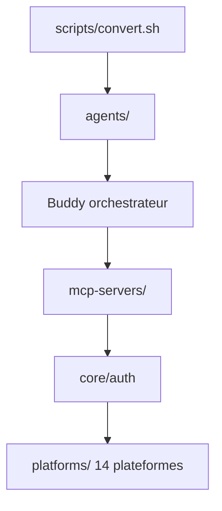

# itallstartedwithaidea/advertising-hub

> Collection of AI agents, MCP servers and utilities for driving the advertising APIs of fourteen platforms.

## The problem
Advertising APIs (Google, Meta, Microsoft, Amazon...) are scattered, and no tool links agents, authentication and data models across them.

## What it actually does
Gathers more than twenty-five agent specifications (PPC strategist, auditor, attribution analyst, budget allocator), an MCP server registry and a `core/` package (authentication, normalised models, rate limiting, errors). Only the Google Ads MCP is announced as live; the others are specifications or planned. Scripts generate integrations for Cursor, Gemini CLI or Windsurf.

## How it is wired


## Trying it
```bash
cp -r agents/ ~/.claude/agents/advertising-hub/
./scripts/convert.sh
./scripts/install.sh
```

## Cost and gotchas
Each advertising platform requires an account and API credentials; calls act on real ad spend. The README says nothing about telemetry.

## What it is not
It is not a ready-to-use product: most of the MCP servers are not written. It is not a data science tool.

## Alternatives
- google-ads-mcp: a live Google Ads MCP server, cited in the README.
- The Agency: the foundation of the agents.

## For you
Worth watching: interesting if you automate ad campaigns with agents, but only one server is real and the project rests on one person.
